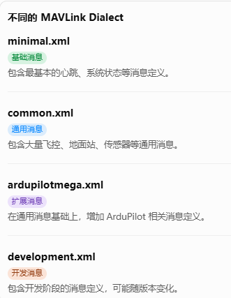
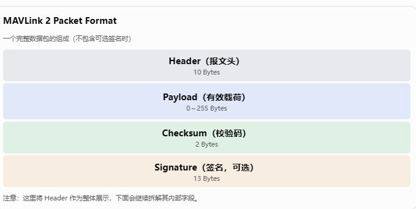
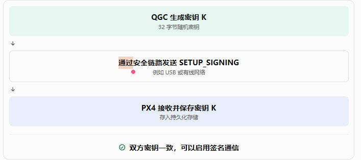
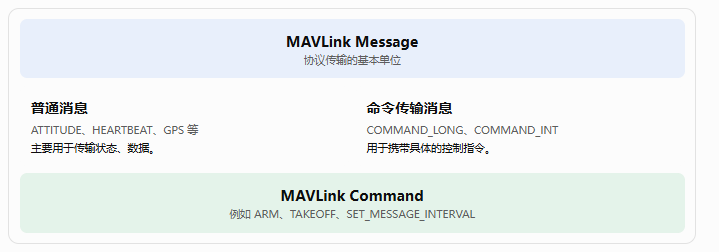
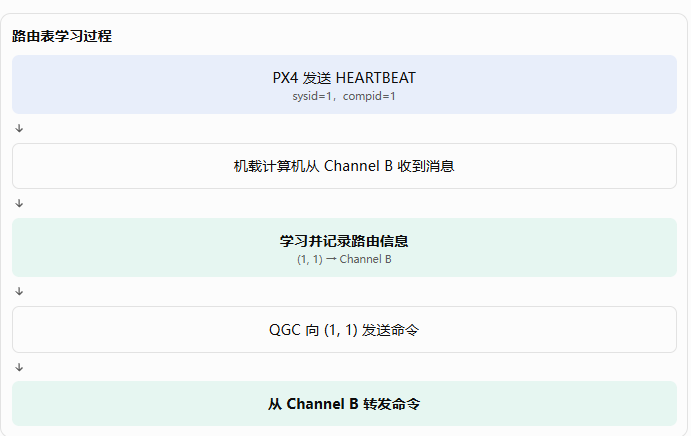
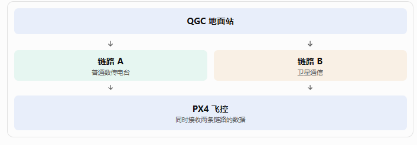
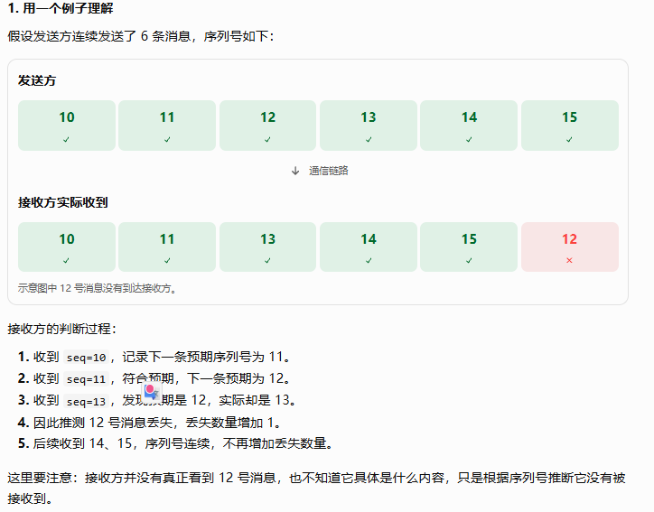
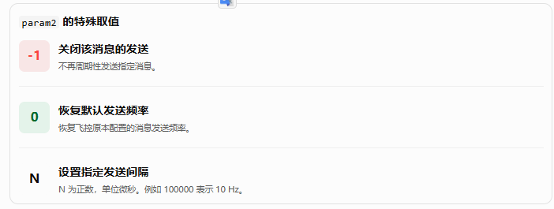

# MAVLINK

## 简介


MAVLink是一种非常轻量级的消息传输协议, 用于地面控制终端（地面站）与无人机之间 (以及机载无人机组件之间) 进行通信。

Mavlink 遵循现代混合**发布-订阅**和点对点设计模式: 数据流作为 **topics** 发送/发布的, 而配置子协议 (如 [路径点协议 ](https://mavlink.io/zh/services/mission.html)或 [参数协议](https://mavlink.io/zh/services/parameter.html)）是基于重传机制的**点对点模式**。

> + 发布-订阅：我有数据就广播出去，谁需要谁接收。
>
>   > 假设无人机正在飞行，飞控需要不断向地面站发送以下数据：它们会不断变化，需要周期性地更新。
>   >
>   > + 无人机当前位置。
>   > + 当前飞行姿态。
>   > + 电池电压。
>   > + GPS 状态。
>   > + 飞行模式。
>   >
>   > 如果每次都采用一问一答的方式，显然非常麻烦。因此，采用发布-订阅模式更合适。
>   >
>   > 1. PX4 获取飞控内部的状态数据。
>   > 2. PX4 将数据封装成 MAVLink 消息。
>   > 3. 按照配置的发送频率，不断向外发送。
>   > 4. QGC 接收到消息后更新地图、仪表盘和状态显示。
>   >
>   > 这里的 topics 可以理解为不同的数据主题，例如位置主题、姿态主题等。
>
> + 点对点：我需要你完成一件具体的事情，我们之间通过请求和应答完成交互，必要时还会重传。
>
>   > 再考虑另一个场景。现在你使用 QGC 规划了一条无人机航线，希望将航点上传到飞控。这和前面的位置数据发送不一样。因为航点上传不是简单地发送一串数据就结束了，而是需要保证：
>   >
>   > + 飞控确实收到了航点。
>   > + 飞控知道总共有多少个航点。
>   > + 飞控能够正确接收每个航点。
>   > + 地面站知道飞控是否接收成功。
>   > + 如果某个航点丢失，需要重新发送。


消息在 XML 文件中定义。每个xml文件对应一个特定的MAVLink系统，并为该系统定义了专属的消息集（亦被称之为“方言dialect”）。 *大部分* 地面站和自动驾驶仪所采用的“通用消息集”定义于 [common.xml](https://mavlink.io/zh/messages/common.html)中 (大多数“语支”均是基于“通用消息集“*构建* 的：即，大多数“语支”所对应的xml文件里，均包含了common.xml) 。

代码生成器（[Code generators](https://mavlink.io/zh/getting_started/generate_libraries.html)）根据这些XML消息定义，为特定编程语言创建软件库（ [specific ](https://mavlink.io/zh/#supported_languages) 、 [programming languages](https://mavlink.io/zh/#supported_languages)），供无人机、地面控制站及其他MAVLink系统使用以实现通信。生成的库通常采用MIT许可证，因此可以在任何闭源应用中无限制地使用，而无需公开该闭源应用的源代码。

**C语言参考实现是一个==仅包含头文件的库==**，针对资源受限系统（如内存和闪存有限的设备）进行了高度优化。该库经过实际验证，并已广泛应用于多种产品中，作为不同制造商组件之间的互操作性接口。

> 在 MAVLink 中，Dialect（方言）可以理解为一套具体的 MAVLink 消息定义集合。
>
> 它规定了一个 MAVLink 系统能够识别和使用哪些消息，以及这些消息分别包含什么字段、使用什么数据类型、对应什么消息 ID。
>
> 你可以把它理解成：MAVLink 是一种通信语言，而 Dialect 是这门语言的一本特定词典。
>
> 1. **为什么 MAVLink 需要 Dialect？**
>
> 先回忆一下我们之前学过的 MAVLink 消息。
>
> 例如，MAVLink 定义了一条 `ATTITUDE` 消息：
>
> ```
> <message id="30" name="ATTITUDE">
>     <field type="uint32_t" name="time_boot_ms"/>
>     <field type="float" name="roll"/>
>     <field type="float" name="pitch"/>
>     <field type="float" name="yaw"/>
>     <field type="float" name="rollspeed"/>
>     <field type="float" name="pitchspeed"/>
>     <field type="float" name="yawspeed"/>
> </message>
> ```
>
> 这条消息规定了：
>
> + 消息名称：`ATTITUDE`
> + 消息 ID：30
> + 包含哪些字段
> + 每个字段的数据类型
>
> 但 MAVLink 不只有这一条消息。
>
> 它还定义了：
>
> + `HEARTBEAT`：心跳消息
> + `GPS_RAW_INT`：GPS 原始数据
> + `GLOBAL_POSITION_INT`：全球位置
> + `BATTERY_STATUS`：电池状态
> + `COMMAND_LONG`：命令消息
> + `MISSION_ITEM_INT`：航点任务消息
>
> 如果所有消息都写在一个 XML 文件中，文件会非常庞大，也不方便管理。
>
> 于是 MAVLink 将消息定义组织成不同的 XML 文件，并通过 Dialect 将它们组合起来。
>
> 2. **Dialect 到底是什么？**
>
> 先看 MAVLink 仓库中的消息定义目录：
>
> ```sh
> message_definitions/
> └── v1.0/
>     ├── minimal.xml
>     ├── standard.xml
>     ├── common.xml
>     ├── development.xml
>     ├── ardupilotmega.xml
>     └── ...
> ```
>
> 
>
> 这里有一个重要细节：
>
> Dialect 不一定是一个 XML 文件中独立定义的全部消息，它也可以通过 include 引用其他 XML 文件。
>
> 例如，`ardupilotmega.xml` 可以引用 `common.xml`，从而在通用消息的基础上增加自己的消息。
>
> 所以，Dialect 更准确的定义是：
>
> > 一套由 XML 消息定义文件及其引用关系组成的 MAVLink 消息定义集合。
>
> | 概念            | 负责什么                                   |
> | --------------- | ------------------------------------------ |
> | MAVLink 协议    | 规定数据包如何组织、如何校验、如何传输     |
> | MAVLink Dialect | 规定具体有哪些消息，以及消息内部的数据结构 |
> | XML             | 描述消息定义的文件格式                     |
> | mavgen          | 将 XML 定义生成 C/C++ 等语言的代码         |
>
> 一个 Dialect 就是以某个 XML 文件为入口，通过 `<include>` 引用它所依赖的其他 XML 文件，最终形成的一套完整 MAVLink 消息定义集合。
>
> ```sh
> ardupilotmega.xml        ← Dialect 入口文件
>     │
>     └── include common.xml
>               │
>               └── include standard.xml
>                         │
>                         └── include minimal.xml
> ```
>
> 当你使用 `ardupilotmega.xml` 作为 `mavgen` 的输入时，生成器会沿着这些引用关系读取相关 XML，最终生成包含这些消息定义的代码库。
>
> 记住三个概念：
>
> + 入口 XML：指定使用哪套 Dialect。
> + include XML：提供被引用的消息定义。
> + Dialect：所有相关 XML 定义共同组成的消息集合。
>
> 因此，你以后看到 PX4 配置中的 `CONFIG_MAVLINK_DIALECT=development`，就可以理解为：PX4 选择以 `development.xml` 为入口，生成对应的 MAVLink 消息库。

###  综述

#### 飞控通讯协议概况


MAVLink 为一种设计用于资源受限系统及带宽受限链路的二进制遥测协议。 MAVLink 主要发行了两个版本: v1.0 和 v2.0 ，这两个版本向后兼容 （即 v2.0 版可以分析和发送 v1.0 版数据包)。

遥测数据流采用多播设计发送，而影响系统配置且需要保证可靠传输的协议（如任务协议或参数协议）则采用点对点方式，并带有重传机制。

#### MAVLink 2 Packet Format

MAVLink 2 的数据包，本质上就是一段按照固定格式排列的字节序列。每个字节或字节区域都有特定含义，接收方按照相同的规则解析这些字节，就能还原出发送方想表达的信息。
	MAVLink 2 数据包在通信链路上传输时的实际数据格式（Packet Format）：

```c
uint8_t magic;              ///< protocol magic marker 协议标识符
uint8_t len;                ///< Length of payload Payload 长度
uint8_t incompat_flags;     ///< flags that must be understood
uint8_t compat_flags;       ///< flags that can be ignored if not understood
uint8_t seq;                ///< Sequence of packet
uint8_t sysid;              ///< ID of message sender system/aircraft
uint8_t compid;             ///< ID of the message sender component
uint8_t msgid 0:7;          ///< first 8 bits of the ID of the message
uint8_t msgid 8:15;         ///< middle 8 bits of the ID of the message
uint8_t msgid 16:23;        ///< last 8 bits of the ID of the message
uint8_t payload[max 255];   ///< A maximum of 255 payload bytes
uint16_t checksum;          ///< CRC-16/MCRF4XX
```

```c
uint8_t signature[13];      ///< Signature which allows ensuring that the link is tamper-proof (optional)
```




MAVLink 2 数据包的长度计算公式是：
$$
 L=10+P+2+S 
$$
其中：

+ \(L\)：数据包总长度。
+ \(P\)：Payload 长度，范围 0～255 字节。
+ \(S\)：签名长度，未启用签名时为 0，启用时为 13。

因此：

+ 不带签名时，最大长度为 267 字节。
+ 带签名时，最大长度为 280 字节。

这里的 10 字节 Header 是固定长度，2 字节校验码也是固定长度。


Header 的作用是告诉接收方：

+ 这是一个什么协议的数据包？
+ 数据包有多长？
+ 发送方是谁？
+ 发送的是哪一种消息？
+ 数据包的顺序是什么？

Header 一共有 10 个字节。


1. `magic` ：协议标识符

   > ```c
   > uint8_t magic;
   > ```
   >
   > 它是 MAVLink 数据包的起始标志。
   >
   > MAVLink 2 的标识字节为：
   >
   > ```
   > 0xFD
   > ```
   >
   > MAVLink 1 则使用：
   >
   > ```
   > 0xFE
   > ```
   >
   > 为什么需要这个字段？
   >
   > 假设飞控不断从串口读取数据：
   >
   > ```
   > 12 35 48 9A FD 09 00 00 ...
   > ```
   >
   > 接收方并不知道从哪个字节开始才是一个完整的 MAVLink 数据包。
   >
   > 因此，它会在接收的数据流中寻找 `0xFD`，将其作为 MAVLink 2 数据包的起始标志。
   >
   > 这就是所谓的帧同步（Frame Synchronization）。
   >
   > 你可以把它理解成一段连续文本中的特殊分隔符，用来告诉接收方：
   >
   > 从这里开始，尝试解析一个 MAVLink 2 数据包。

2. `len`：Payload 长度

   > ```
   > uint8_t len;
   > ```
   >
   > 这个字段表示有效载荷的字节数。
   >
   > 例如：
   >
   > ```
   > len = 9
   > ```
   >
   > 就表示 Payload 部分有 9 个字节。
   >
   > 为什么需要它？
   >
   > 因为不同的 MAVLink 消息包含的数据不同，长度也不同。
   >
   > 例如：
   >
   > + HEARTBEAT：包含飞行器类型、系统状态等信息。
   > + ATTITUDE：包含滚转角、俯仰角、偏航角和角速度。
   > + GPS_RAW_INT：包含经纬度、高度、GPS 状态等信息。
   >
   > 接收方通过 `len` 就可以知道应该读取多少个有效载荷字节。
   >
   > 注意：MAVLink 2 允许对 Payload 尾部的零字节进行截断，因此实际发送的长度可能小于消息定义的完整长度。

3.  `incompat_flags`：不兼容标志

   > 这个字段用于标记数据包使用了哪些特殊功能。
   >
   > 这里的“不兼容”不是说数据包本身有错误，而是说：
   >
   > 如果接收方不支持数据包声明的某种功能，就不能正确处理这个数据包，必须丢弃它。
   >
   > 举个例子。
   >
   > MAVLink 2 支持消息签名。如果发送方发送了一个带签名的数据包，就需要在 `incompat_flags` 中设置对应的标志位：
   >
   > ```
   > MAVLINK_IFLAG_SIGNED = 0x01
   > ```
   >
   > 也就是：
   >
   > ```
   > incompat_flags = 0x01
   > ```
   >
   > 接收方看到这个标志，就知道后面还有 13 字节的签名数据。
   >
   > 如果接收方不支持签名机制，就不能简单地忽略这个标志，因为它不知道如何正确处理这个数据包，所以必须丢弃。
   >
   > 你可以把它理解成：
   >
   > > 这个数据包使用了一种特殊格式，你必须认识这种格式才能处理它。

4.  `compat_flags`：兼容标志

   > ```
   > uint8_t compat_flags;
   > ```
   >
   > 这个字段与上面的 `incompat_flags` 很相似，但有一个重要区别。
   >
   > 它表示一些接收方可以忽略、不会影响正常解析的功能标志。
   >
   > 例如，假设未来 MAVLink 增加了一种优先级标记：
   >
   > ```
   > compat_flags = 0x01
   > ```
   >
   > 如果某个旧版本接收方不认识这个标志，它仍然可以按照原有规则解析数据包。
   >
   > 所以二者的区别是：
   >
   > | 字段             | 接收方不认识标志时怎么办？ |
   > | ---------------- | -------------------------- |
   > | `incompat_flags` | 必须丢弃数据包             |
   > | `compat_flags`   | 可以忽略标志，继续解析     |
   >
   > 这是 MAVLink 协议考虑向后兼容性的一种设计。

5. ` seq`：数据包序列号

   > 这个字段表示数据包的发送序号。
   >
   > 它的取值范围是：
   > $$
   >  0\sim255 \
   > $$
   > 发送方每发送一个 MAVLink 数据包，序列号就递增一次。
   >
   > 例如：
   >
   > ```
   > 第1个数据包：seq = 0
   > 第2个数据包：seq = 1
   > 第3个数据包：seq = 2
   > 第4个数据包：seq = 3
   > ```
   >
   > 当序列号达到 255 后，会重新从 0 开始：
   >
   > ```
   > 253 → 254 → 255 → 0 → 1
   > ```
   >
   > 为什么需要序列号？
   >
   > 主要用于检测数据包丢失。
   >
   > 假设 PX4 连续发送了四个数据包：
   >
   > ```
   > PX4发送：  10  11  12  13
   >                   ↓
   > 网络传输： 10  11  ×   13
   >                   ↓
   > QGC接收： 10  11      13
   > ```
   >
   > QGC 发现：
   >
   > ```
   > 11 → 13
   > ```
   >
   > 中间缺少了序号 12，就可以判断可能发生了数据包丢失。
   >
   > 注意：序列号主要用于检测丢包，并不意味着 MAVLink 会自动重传丢失的数据包。是否重传取决于上层协议，例如 Mission Protocol 和 Parameter Protocol。

6. `sysid`：系统 ID

   > 这个字段表示发送方所属的系统编号。
   >
   > 这里的 System 可以理解为一架无人机或者一个独立的 MAVLink 系统。
   >
   > 例如：
   >
   > ```
   > 无人机 A：sysid = 1
   > 无人机 B：sysid = 2
   > 无人机 C：sysid = 3
   > ```
   >
   > 假设一个 QGC 同时连接了三架无人机，那么它就可以通过 `sysid` 区分消息来自哪一架无人机。
   >
   > 例如：
   >
   > ```
   > 消息 A：sysid = 1
   > 消息 B：sysid = 2
   > 消息 C：sysid = 3
   > ```
   >
   > 这样就能避免不同无人机的数据混淆。

7. ` compid`：组件 ID

   > 这个字段表示发送消息的具体组件编号。
   >
   > 这里要注意：
   >
   > 一个系统（System）内部可以包含多个组件（Component）。
   >
   > 例如，一架无人机内部可能有：
   >
   > + 飞控自动驾驶组件。
   > + 相机组件。
   > + 云台组件。
   > + 伴飞计算机上的 MAVLink 组件。
   >
   > 它们可以属于同一个系统，但具有不同的组件 ID。
   >
   > 例如：
   >
   > ```
   > 无人机系统：
   > sysid = 1
   > 
   >     飞控组件：
   >     compid = 1
   > 
   >     相机组件：
   >     compid = 100
   > 
   >     云台组件：
   >     compid = 154
   > ```
   >
   > 所以：
   >
   > + `sysid` 用于区分不同的系统。
   > + `compid` 用于区分同一系统内的不同组件。

8. ` msgid`：消息 ID

   > 
   >
   > ```
   > uint8_t msgid 0:7;
   > uint8_t msgid 8:15;
   > uint8_t msgid 16:23;
   > ```
   >
   > 这是 MAVLink 2 相比 MAVLink 1 的一个重要改进。
   >
   > MAVLink 2 使用 24 位消息 ID，也就是三个字节。
   >
   > 它的取值范围是：
   > $$
   >  0\sim 2^{24}-1 
   > $$
   > 最多可以表示：\[ 16,777,216 \]
   >
   > 种不同的消息编号。
   >
   > 为什么需要消息 ID？
   >
   > 因为 MAVLink 定义了很多不同类型的消息。
   >
   > 例如：
   >
   > | 消息名称     | Message ID | 用途         |
   > | ------------ | ---------- | ------------ |
   > | HEARTBEAT    | 0          | 心跳消息     |
   > | SYS_STATUS   | 1          | 系统状态     |
   > | GPS_RAW_INT  | 24         | GPS 原始数据 |
   > | ATTITUDE     | 30         | 姿态信息     |
   > | COMMAND_LONG | 76         | 长命令消息   |
   > | COMMAND_ACK  | 77         | 命令执行结果 |
   >
   > 当接收方收到一个数据包时，可以根据 `msgid` 判断 Payload 应该按照哪一种消息结构解析。
   >
   > 例如：
   >
   > ```
   > msgid = 30
   > ```
   >
   > 接收方就知道这是 `ATTITUDE` 消息，然后按照 ATTITUDE 的消息定义解析 Payload 中的滚转角、俯仰角、偏航角等数据。
   >
   >  为什么要拆成三个字节？
   >
   > 因为一个字节只有 8 位，而 MAVLink 2 的消息 ID 有 24 位。
   >
   > 所以拆分为：
   >
   > ```
   > msgid 0:7     低8位
   > msgid 8:15    中间8位
   > msgid 16:23   高8位
   > ```
   >
   > 例如，假设消息 ID 为：
   >
   > ```
   > 0x123456
   > ```
   >
   > 那么在线传输时，三个字节的顺序为：
   >
   > ```
   > 56 34 12
   > ```
   >
   > 这是因为 MAVLink 的多字节字段采用**小端序**（Little Endian）传输。

9. `Payload`：有效载荷

   > 这是整个 MAVLink 数据包中真正承载业务数据的部分。
   >
   > 前面的 Header 主要用于描述数据包本身，而 Payload 才是具体的消息内容。
   >
   > 例如，我们想发送无人机的姿态信息。
   >
   > MAVLink 定义了 `ATTITUDE` 消息：
   >
   > ```
   > ATTITUDE
   >     time_boot_ms
   >     roll
   >     pitch
   >     yaw
   >     rollspeed
   >     pitchspeed
   >     yawspeed
   > ```
   >
   > 它的含义是：
   >
   > | 字段           | 含义             |
   > | -------------- | ---------------- |
   > | `time_boot_ms` | 飞控启动后的时间 |
   > | `roll`         | 横滚角           |
   > | `pitch`        | 俯仰角           |
   > | `yaw`          | 偏航角           |
   > | `rollspeed`    | 横滚角速度       |
   > | `pitchspeed`   | 俯仰角速度       |
   > | `yawspeed`     | 偏航角速度       |
   >
   > 例如：
   >
   > ```
   > roll  = 0.1
   > pitch = 0.2
   > yaw   = 1.5
   > ```
   >
   > 这些数据经过序列化后，就会被放进 Payload 中。
   >
   > 这里有一个非常重要的知识点：
   >
   > Payload 并不是简单地将 C++ 结构体的内存直接复制到通信缓冲区中。
   >
   > MAVLink 有自己规定的序列化规则。
   >
   > 例如，消息字段会按照数据类型大小进行排序：
   >
   > 1. 8 字节类型优先。
   > 2. 4 字节类型其次。
   > 3. 2 字节类型再次。
   > 4. 1 字节类型最后。
   >
   > 这样做可以减少结构体对齐方面的问题，提高序列化和反序列化效率。
   >
   > 另外，MAVLink 2 还支持尾部零字节截断。
   >
   > 例如，一个消息原本有 20 字节 Payload，但最后 4 个字节都是 0，那么发送方可以将尾部的 4 个零字节省略，同时修改 `len` 字段。
   >
   > 这样可以节省通信带宽。
   >
   > 注意：只截断 Payload 末尾连续的零字节，不会删除中间的零字节；第一个 Payload 字节也不会被截断。接收方需要按照消息定义恢复省略的尾部字段。
   >
   > 这对于带宽有限的无人机遥测链路很有价值。

10. `Checksum` : 校验码

    > 这个字段占用 2 个字节，使用 CRC-16/MCRF4XX 算法计算。
    >
    > 它的主要作用是：
    >
    > 检测数据包在传输过程中是否发生了数据损坏。
    >
    > 举个例子。
    >
    > 假设 PX4 发送：
    >
    > ```
    > roll = 0.1
    > pitch = 0.2
    > yaw = 1.5
    > ```
    >
    > 但由于通信干扰，接收方实际收到的数据变成：
    >
    > ```
    > roll = 0.1
    > pitch = 0.8
    > yaw = 1.5
    > ```
    >
    > 此时，接收方重新计算数据包的 CRC，与收到的 `checksum` 比较，就能发现数据发生了变化。
    >
    > 如果校验失败，就可以丢弃这个数据包。

11. `Signature`：数字签名

    > 这个字段是可选的，占用 13 字节。
    >
    > 它属于 MAVLink 2 的消息签名机制。
    >
    > 这里我想纠正一个容易产生误解的地方：官网注释中的 `tamper-proof` 不应该理解为加密。
    >
    > MAVLink 签名主要用于验证消息是否来自持有相同密钥的可信发送方，以及检测消息是否被篡改；它不负责隐藏消息内容。
    >
    > 例如：
    >
    > 假设你的无人机通过无线电与地面站通信。
    >
    > 如果没有签名机制，其他设备可能伪装成合法的 MAVLink 发送方，向飞控发送控制命令。
    >
    > 启用签名后，接收方可以验证消息签名，拒绝不符合认证要求的消息。
    >
    > 1. 13 字节签名包含什么？
    >
    > 它由三个部分组成：
    >
    > | 字段      | 长度   | 作用         |
    > | --------- | ------ | ------------ |
    > | Link ID   | 1 字节 | 标识通信链路 |
    > | Timestamp | 6 字节 | 消息时间戳   |
    > | Signature | 6 字节 | 消息认证签名 |
    >
    > 其中 Signature 是基于 SHA-256 计算得到的 48 位摘要。
    >
    > 发送方和接收方需要事先共享一个 32 字节的密钥。
    >
    > 2. 如何知道数据包是否包含签名？
    >
    > 通过前面的：
    >
    > ```
    > uint8_t incompat_flags;
    > ```
    >
    > 如果其中的：
    >
    > ```
    > MAVLINK_IFLAG_SIGNED = 0x01
    > ```
    >
    > 被置位，就说明这个数据包带有签名，接收方需要按照签名格式处理。
    >
    > 如果你目前只是使用 USB 或串口连接 Pixhawk 4 和 QGC，暂时不需要深入研究签名算法，但建议你知道它的存在。


整个过程可以理解为：

Pixhawk 4 发送 ATTITUDE 消息

1. 确定消息类型

   `msgid = 30`

   告诉接收方这是 ATTITUDE 消息。

2. 填充消息内容

   Payload 中放入时间、横滚角、俯仰角、偏航角以及角速度。

3. 添加发送方信息

   填写 `sysid`、`compid` 和 `seq`。

4. 构造数据包头

   填写 `magic`、`len`、`incompat_flags` 和 `compat_flags`。

5. 计算 CRC

   对数据包进行校验计算，生成 `checksum`。

6. 可选添加签名

   如果启用了消息签名，则在末尾添加 13 字节签名。

7. 发送数据

   通过 USB、UART 或 UDP 等通信链路发送字节流。

接收方 QGC 则进行相反的操作：

1. 寻找 `0xFD`，确定数据包起始位置。
2. 读取 Header，获得 Payload 长度和消息 ID。
3. 根据 `len` 读取 Payload。
4. 检查 CRC。
5. 如果有签名，验证签名。
6. 根据 `msgid` 找到对应的消息定义。
7. 解析 Payload，获得姿态数据。
8. 更新 QGC 中的姿态显示。

### FAQ

#### MAVLink 的效率如何？
​	MAVLink 是一种非常高效的协议。MAVLink 1 每个数据包仅有 8 字节的开销，包括起始符和数据包丢弃检测。MAVLink 2 的开销仅为 12 字节（如果使用签名则为 25 字节），但如今它已成为一种扩展性更强的协议。


#### MAVLink 支持多少辆交通工具？
255 辆车，系统 ID 范围为 1 到 255（0 不是有效的车辆 ID）。

严格来说，MAVLink 支持 255 个并发系统，这些系统可以包括飞行器、地面站、天线跟踪器以及其他硬件的混合组合。

#### 我可以在哪些地方使用 MAVLink？
MAVLink 已在多种微控制器和操作系统上验证可用，包括 ARM7、ATMega、dsPic、STM32，以及 Windows、Linux、macOS、Android 和 iOS。

#### MAVLink的安全性如何？

MAVLink 提供消息签名功能，使系统能够验证消息是否来自可信来源。MAVLink 不提供消息加密功能。

#### MAVLink 如何在字节流中检测并解码消息？  
MAVLink 首先等待数据包的起始标志，然后读取数据包长度，并在 n 个字节后匹配校验和。如果校验和匹配，则返回已解码的数据包，并再次等待起始标志；如果字节被篡改或丢失，则会丢弃当前消息，继续尝试下一个消息。

#### MAVLink 只使用一个起始标志，这难道不如使用两个或三个起始标志更安全吗？
否。我们使用CRC校验来可靠地确定是否已成功接收到完整的消息。虽然增加额外的起始标志可能提高检测起始点的概率，但无法提升消息有效性的确定性。由于额外的标志会增加通信链路中的字节数，因此我们决定不使用它们。

#### 系统和组件ID有什么作用？  
系统ID用于标识特定的MAVLink系统（如飞行器、地面控制站等）。MAVLink可同时支持最多255个系统。组件ID则表示属于更大系统中的某个子组件——例如，一个系统可能包括自动驾驶仪、辅助计算机和/或摄像头，这些都可以单独进行通信。因此，组件ID使得MAVLink既可用于机载通信，也可用于机外通信。

#### 为什么MAVLink头中的序列号是必需的？  
MAVLink是无人飞行系统中安全关键组件的一部分。如果通信链路出现丢包，可能会危及飞行器的安全，因此必须对其进行监控。通过在头部添加序列号，MAVLink可以持续反馈数据包丢失率，从而使飞行器或地面控制站能够及时采取行动。

#### 如何进一步减小生成的C库大小？  
在资源极为有限的系统上，您可以通过设置 MAVLINK_COMM_NUM_BUFFERS=1 和 MAVLINK_MAX_PAYLOAD_LEN="您最大缓冲区的大小"（假设仅有一个通信链路，且您的有效载荷小于MAVLink支持的最大值）来减小生成的库文件大小。同时，您还应确保传递给MAVLink的所有缓冲区尽可能小（例如，传递给 mavlink_msg_to_send_buffer() 的缓冲区）。  

另一种选择是使用其他生成工具。例如，fastMavlink声称其体积更小、效率更高，优于由 mavgen 生成的库（但这一点尚未经过MAVLink项目验证）。

## 开始使用

Download or Generate MAVLink source files for your [dialect](https://mavlink.io/en/messages/dialects.html#dialects):

+ **Download the [pre-built MAVLink source files](https://mavlink.io/en/#prebuilt_libraries)** if you're working in a C/C++ project and using standard dialects.

+ Generate the MAVLink source files

   to use any other 

  supported language

  , add/modify messages or dialects, or use the example scripts:

  1. [Install MAVLink](https://mavlink.io/en/getting_started/installation.html)
  2. [Generate Language-Specific Source Files](https://mavlink.io/en/getting_started/generate_libraries.html).

The following topics explain how to include the files in your project and use MAVLink:

+ [Use the MAVLink Source Files](https://mavlink.io/en/getting_started/use_libraries.html) explains how to include the source files in your project and send messages.
+ [Message Definitions](https://mavlink.io/en/messages/) contains human-readable explanations of the messages.
+ [Microservices](https://mavlink.io/en/services/) explains the main sub-protocols for working with missions, cameras, images, parameters etc.

### 下载MAVLink 工具链

本主题说明如何安装MAVLink工具链。该工具链包含XML消息定义，以及使用这些定义生成MAVLink源文件的图形界面/命令行工具。

> 如果你使用的是C编程语言和标准定义，或MAVLink仓库中发布的方言，则无需安装或生成源文件。只需获取预编译的库文件，然后跳转到“使用C库”部分即可。


#### Prerequisites

The requirements for using the *MAVLink generator* are:

+ Python 3
+ Python 3 Pip
+ [TkInter](https://wiki.python.org/moin/TkInter) (required to use the GUI tool), included as of Python 3.7.

If you are creating new XML definitions you should also install lxml and libxml2 for XML validation and formatting.

#### Installation

To install the MAVLink toolchain:

1. Install Python 3.10+:

   + **Windows:** Download from [Python for Windows](https://www.python.org/downloads/)

   + **Ubuntu Linux** Make sure Python and Pip are both installed:

     

     ```
     sudo apt install python3 python3-pip
     ```

2. Clone the official [mavlink repo](https://github.com/mavlink/mavlink) or your fork with your custom dialect:

   

   ```
   git clone https://github.com/mavlink/mavlink.git --recursive
   cd mavlink
   ```

3. Install the required packages:

   

   ```
   python3 -m pip install -r pymavlink/requirements.txt
   ```

Now you are ready to [Generate MAVLink Libraries](https://mavlink.io/en/getting_started/generate_libraries.html).


### 生成 MAVLink 库

可以使用代码生成工具，根据XML消息定义（ [XML Message Definitions](https://mavlink.io/en/messages/)）创建特定语言的MAVLink库。

本页面展示了如何使用MAVLink项目提供的以下两个代码生成器：

+ GUI tool: [mavgenerate](https://mavlink.io/en/getting_started/generate_libraries.html#mavgenerate)
+ Command line tool: [mavgen](https://mavlink.io/en/getting_started/generate_libraries.html#mavgen), which is the backend tool used also by mavgenerate

>  这些生成器可以为以下编程语言生成MAVLink 2和MAVLink 1库：C、C++11、Python、TypeScript、Java和WLua。仅支持MAVLink 1库的编程语言包括：C#、JavaScript、ObjC、Swift。

先决条件：

1. 您必须已经安装了MAVLink工具链，其中包含本文中使用的mavgenerate和mavgen工具，以及XML消息定义文件。
2. ==**如果您要为自定义协议生成消息，请将该协议的XML定义文件复制到message_definitions/v1.0/目录下。**==

> 编写自定义 MAVLink Dialect（方言）时，XML 文件应该放在 PX4 内置 MAVLink 仓库的 `message_definitions/v1.0/` 目录下，与 `common.xml`、`standard.xml` 等官方 XML 放在一起，才能保证 `mavgen` 正确找到它所依赖的其他 XML 文件。

#### 使用 Mavgenerate GUI 构建 MAVLink 库

mavgenerate.py 是一个用 Python 编写的 MAVLink 图形用户界面代码生成器。


Mavgenerate 提供了一个图形用户界面（GUI）前端，用于操作 mavgen 命令行代码生成器，并支持相同的选项。

可以通过 Python 的 -m 参数从任何位置启动 GUI：

```sh
python3 -m mavgenerate
```


生成MAVLink库代码的步骤：


1. 选择目标 XML 文件

   > （通常位于mavlink/message_definitions/1.0）。
   >
   > > 如果使用自定义方言，请先将其复制到上述目录中（如果该方言依赖于 common.xml，则必须位于同一目录内）.

2. 选择输出目录（例如 mavlink/include）。

3. 选择目标输出编程语言。

   > 

4. 选择目标 MAVLink 协议版本。如果生成器支持，建议使用 2.0。

   > 如果所选编程语言不支持该协议，生成将失败。

5. 可选地检查“验证”和/或“验证单位”，以验证XML规范。

6. 点击“ **Generate**”以创建 MAVLink 库和所选方言的源文件。


#### 使用 Mavgen 命令行工具构建 MAVLink 库

mavgen.py 是一个用于为各种编程语言生成 MAVLink 库的命令行工具。你可以从 mavlink 目录下运行 mavgen。但如果你在 mavlink 目录之外，需要将 mavlink 目录添加到 PYTHONPATH 环境变量中。

以下是一个示例，展示如何使用名为 your_custom_dialect.xml 的方言来为 C 语言生成 MAVLink 2 库：

```sh
python3 -m pymavlink.tools.mavgen --lang=C --wire-protocol=2.0 --output=generated/include/mavlink/v2.0 message_definitions/v1.0/your_custom_dialect.xml
```

生成 Python 模块的语法相同，只是 --output 参数指定的是文件名而不是目录。

完整的语法和选项可通过运行 mavgen.py -h 标志来输出，如下所示：

```shell
usage: mavgen.py [-h] [-o OUTPUT] [--lang {Ada,C,CS,JavaScript,JavaScript_Stable,JavaScript_NextGen,TypeScript,Python2,Python3,Python,Lua,WLua,ObjC,Swift,Java,C++11}]
                 [--wire-protocol {0.9,1.0,2.0}] [--no-validate] [--error-limit ERROR_LIMIT] [--strict-units]
                 XML [XML ...]

This tool generate implementations from MAVLink message definitions

positional arguments:
  XML                   MAVLink definitions

options:
  -h, --help            show this help message and exit
  -o OUTPUT, --output OUTPUT
                        output directory.
  --lang {Ada,C,CS,JavaScript,JavaScript_Stable,JavaScript_NextGen,TypeScript,Python2,Python3,Python,Lua,WLua,ObjC,Swift,Java,C++11}
                        language of generated code [default: Python]
  --wire-protocol {0.9,1.0,2.0}
                        MAVLink protocol version. [default: 1.0]
  --no-validate         Do not perform XML validation. Can speed up code generation if XML files are known to be correct.
  --error-limit ERROR_LIMIT
                        maximum number of validation errors to display
  --strict-units        Perform validation of units attributes.
```

### Generate Source Files for ROS

To add MAVlink [messages/dialects](https://mavlink.io/en/messages/) while working with ROS:

1. Follow the [MAVROS source install instructions](https://github.com/mavlink/mavros/blob/master/mavros/index.md#source-installation) to install the mavlink-gbp-release which is the MAVlink library released for ROS.

2. Uninstall the MAVlink package for ROS if previously installed.

   

   ```
   sudo apt-get remove ros-${rosversion -d}-mavlink
   ```

   or source `devel/setup.bash` of your catkin workspace to override the library directory.

3. In the `mavlink-gbp-release`, add the new MAVlink message to `common.xml` or add the new dialect `dialect_name.xml` in the `message definitions`. Do not checkout your MAVlink branch because it is not the version synced with ROS.

4. Generate the MAVlink headers `catkin build mavlink`. You can find the headers in `~/catkin_ws/build/mavlink/include/`.

## 使用 MAVLink Libraries(mavgen)

由 `mavgen` 生成的 MAVLink C 库是一个**仅头文件实现**，针对 RAM 和闪存有限的资源受限系统进行了高度优化。

本主题介绍如何获取和使用该c库。

> c++库和C库略有不同，主要是C++库使用类和对象进行封装，但是实现细节是一样的

### 获取  C MAVLink Library

如果你的 XML 定义文件已发布在 MAVLink 仓库中，请从 GitHub 下载 MAVLink 2 库[c_library_v2](https://github.com/mavlink/c_library_v2).。

如果需要自定义方言的库，则需要安装 `mavgen` 并自行生成。这些库可以像预生成的库一样使用。

这些库可以放置在项目目录树中的任意位置，或直接进行生成。

### 添加库到C工程

以下示例假设 MAVLink 头文件位于：`generated/include/mavlink/`。

要在您的C项目中使用MAVLink，请包含对应方言的mavlink.h头文件：

```c
#include <mavlink/your_dialect/mavlink.h>
```

这将自动添加您所使用方言中所有消息的头文件，以及其中包含的任何方言文件。

> **WARNING：**
>
> **一个 C/C++ 程序中，不要直接同时包含多个不同 Dialect 生成的主头文件。如果需要使用多个 Dialect 中定义的消息，应该创建一个新的父 Dialect（Parent Dialect），通过 XML 的** `<include>` **将它们整合起来。**
>
> > 假设你有两个 Dialect：
> >
> > + `common.xml`：定义了 MAVLink 常见消息，例如心跳、姿态、位置等。
> > + `ardupilotmega.xml`：在 common 等消息定义的基础上，增加了 ArduPilot 专用消息。
> >
> > 分别使用 `mavgen` 生成头文件后，可能得到：
> >
> > ```
> > common/
> > └── mavlink.h
> > 
> > ardupilotmega/
> > └── mavlink.h
> > ```
> >
> > 你可能会想在 C++ 程序中这样使用：
> >
> > ```
> > #include <common/mavlink.h>
> > #include <ardupilotmega/mavlink.h>
> > ```
> >
> > **这是官方警告所反对的做法。**
> >
> > 原因主要有两个：
> >
> > 1. 不同 Dialect 可能包含相同的消息定义，导致生成的宏、枚举、结构体和函数出现重复定义。
> > 2. MAVLink 的消息 ID 和消息元信息是通过生成代码组织的。不同 Dialect 的定义集合不一定一致，同时使用两套生成代码容易造成解析、发送和消息识别上的不一致。
> >
> > 尤其需要注意：MAVLink 的消息 ID 并不是全局唯一地绑定到某个 XML 文件的。不同 Dialect 可能使用相同的消息 ID，甚至可能对同一个 ID 定义不同的消息。
> >
> > 因此，不能简单地把多个 Dialect 的生成头文件当作普通的独立头文件库来叠加使用。
>
> **官方推荐的解决办法：创建 Parent Dialect**
>
> 假设你需要同时使用：
>
> + `common.xml` 中的标准消息；
> + `ardupilotmega.xml` 中的 ArduPilot 消息；
> + 你自己定义的无线供电消息。
>
> 那么可以创建一个新的 XML 文件，例如：
>
> ```
> message_definitions/v1.0/
> ├── common.xml
> ├── ardupilotmega.xml
> ├── my_wireless_power.xml
> └── my_parent_dialect.xml
> ```
>
> 其中 `my_parent_dialect.xml`：
>
> ```
> <?xml version="1.0"?>
> <mavlink>
>     <include>common.xml</include>
>     <include>ardupilotmega.xml</include>
>     <include>my_wireless_power.xml</include>
> 
>     <version>3</version>
>     <dialect>0</dialect>
> </mavlink>
> ```
>
> 这里的 `<include>` 就是关键。
>
> 它告诉 `mavgen`：
>
> > 请把这几个 XML 文件中的消息定义整合起来，作为一套完整的 Dialect 处理。
>
> 然后只需要对这个父 Dialect 运行一次 `mavgen`：
>
> ```
> python3 -m pymavlink.tools.mavgen \
>     --lang=C \
>     --wire-protocol=2.0 \
>     --output=/tmp/mavlink_generated \
>     message_definitions/v1.0/my_parent_dialect.xml
> ```
>
> 生成之后，程序只包含父 Dialect 对应的头文件：
>
> ```
> #include <my_parent_dialect/mavlink.h>
> ```
>
> 这样就可以使用父 Dialect 所包含的消息定义。

不要包含单独的源文件。如果你自己生成了头文件，就需要将它们的输出位置添加到C编译器的搜索路径中。

### 添加库到CMake 工程


### Multiple Streams ("channels")

The C MAVLink library utilizes a "channel" metaphor to allow for simultaneous processing of multiple, independent MAVLink streams in the same program. All receiving and transmitting functions provided by this library require a channel, and it is important to use the correct channel for each operation.

By default up to 16 channels may be defined on Windows, Linux and macOS, and up to 4 channels may be define on other systems. Systems can specify a different maximum number of channels/comms buffers using `MAVLINK_COMM_NUM_BUFFERS` (for example, this might be reduced to 1 if running MAVLink on very memory constrained hardware).

If only one MAVLink stream exists, channel 0 should be used by specifying the `MAVLINK_COMM_0` constant.

>  它解决的问题是：当一个程序同时处理多条独立的 MAVLink 通信链路时，如何区分每条链路的数据接收状态、发送状态和解析状态。
>
> MAVLink Channel 是 MAVLink C 库内部用于区分不同通信流的逻辑编号，不等同于物理串口，也不等同于 PX4 中的 MAVLink 实例（Mavlink instance）。


### 接收

MAVLink的接收/解码分为多个阶段：

1. 将接收到的数据流解析为表示每个数据包的对象（mavlink_message_t）。
2. 将数据包有效载荷中包含的MAVLink消息解码为C结构体（该结构体包含映射原始XML定义的字段）。
   以下将演示这些步骤。


#### 解析数据包

`mavlink_parse_char(...)` 是一个便捷函数（位于 `mavlink_helpers.h`），用于解析接收到的 MAVLink 数据。该函数逐字节解析数据，在解析过程中返回 0（`MAVLINK_FRAMING_INCOMPLETE`），当成功解码一个数据包时返回 1（`MAVLINK_FRAMING_OK`）。随着解码进行，`r_mavlink_status` 参数会更新为当前通道的状态/错误信息（可通过 `mavlink_status_t.msg_received` 获取当前字节的解码状态/错误，以及 `mavlink_status_t.parse_state `获取当前解析状态）。当成功解码数据包后，`r_message `参数将被填充为一个表示已解码数据包的对象。

```c
MAVLINK_HELPER uint8_t mavlink_parse_char(uint8_t chan, uint8_t c, mavlink_message_t* r_message, mavlink_status_t* r_mavlink_status)
```

- uint8_t chan：当前通道的ID。  
- uint8_t c：要解析的字符。  
- mavlink_message_t* r_message：成功时，解码后的消息。如果无法解码，则为NULL。 
- mavlink_status_t* r_mavlink_status：通道统计信息，包括当前解析状态的相关信息。  
- 返回值：0表示数据包解码不完整；1表示数据包成功解码。

以下代码片段展示了从串行端口（serial）读取数据时对该函数的典型用法：

```cpp
#include <mavlink/common/mavlink.h>

mavlink_status_t status;
mavlink_message_t msg;
int chan = MAVLINK_COMM_0;

while(serial.bytesAvailable > 0)
{
  uint8_t byte = serial.getNextByte();
  if (mavlink_parse_char(chan, byte, &msg, &status))
    {
    printf("Received message with ID %d, sequence: %d from component %d of system %d\n", msg.msgid, msg.seq, msg.compid, msg.sysid);
    // ... DECODE THE MESSAGE PAYLOAD HERE ...
    }
}
```


#### 解码有效载荷


在上一节中获取的消息/数据包对象（`mavlink_message_t`）包含 MAVLink 数据包/序列化格式中的字段，包括消息 ID（`msgid`）和有效载荷（`payload64`）。

要获取数据包中特定消息的字段，需要进一步解码有效载荷。通常的做法是使用条件语句（`case `语句），将需要解码的消息 ID 映射到相应的解码函数。下面的代码片段展示了对两种消息的处理方式：第一个消息将整个消息解码为 C 结构体，而第二个消息仅获取单个字段：

```c++
if (mavlink_parse_char(chan, byte, &msg, &status)) {
...
```


```c++
    switch(msg.msgid) {
      case MAVLINK_MSG_ID_GLOBAL_POSITION_INT: // ID for GLOBAL_POSITION_INT
        {
          // Get all fields in payload (into global_position)
          mavlink_msg_global_position_int_decode(&msg, &global_position);

        }
        break;
      case MAVLINK_MSG_ID_GPS_STATUS:
        {
          // Get just one field from payload
          visible_sats = mavlink_msg_gps_status_get_satellites_visible(&msg);
        }
        break;
     default:
        break;
    }
```

每种方言中消息的解码器/编码器功能和ID 可在方言文件夹下的独立头文件中找到。这些头文件的命名格式包含消息名称（例如 `mavlink_msg_message_name.h`）。

当您为方言包含 `mavlink.h` 时，方言的单个消息定义会自动被加载，因此您无需单独包含这些内容。

最实用的解码函数名为 `mavlink_msg_message_name_decode()`，它将整个有效载荷提取到一个 C 结构体中（结构体字段映射到原始 XML 消息定义）。此外，还有单独的解码函数，用于仅获取各个字段的值。

例如，通用消息 `GLOBAL_POSITION_INT `被生成到 `common/mavlink_msg_global_position_int.h `中，并包含以下定义：

```c
// Message ID number definition
#define MAVLINK_MSG_ID_GLOBAL_POSITION_INT 33

// Function to decode whole message into C struct
static inline void mavlink_msg_global_position_int_decode(const mavlink_message_t* msg, mavlink_global_position_int_t* global_position_int)

// C-struct with fields mapping to original message
MAVPACKED(
typedef struct __mavlink_global_position_int_t {
 uint32_t time_boot_ms; /*< [ms] Timestamp (time since system boot).*/
 int32_t lat; /*< [degE7] Latitude, expressed*/
 int32_t lon; /*< [degE7] Longitude, expressed*/
 int32_t alt; /*< [mm] Altitude (MSL). Note that virtually all GPS modules provide both WGS84 and MSL.*/
 int32_t relative_alt; /*< [mm] Altitude above ground*/
 int16_t vx; /*< [cm/s] Ground X Speed (Latitude, positive north)*/
 int16_t vy; /*< [cm/s] Ground Y Speed (Longitude, positive east)*/
 int16_t vz; /*< [cm/s] Ground Z Speed (Altitude, positive down)*/
 uint16_t hdg; /*< [cdeg] Vehicle heading (yaw angle), 0.0..359.99 degrees. If unknown, set to: UINT16_MAX*/
}) mavlink_global_position_int_t;

// Function to get just a single field from the payload (in this case, the altitude).
static inline int32_t mavlink_msg_global_position_int_get_alt(const mavlink_message_t* msg)
```


### 命令解码

A [MAVLink Command](https://mavlink.io/en/services/command.html) encodes a command defined in a [MAV_CMD](https://mavlink.io/en/messages/common.html#mav_commands) enum value into a [COMMAND_INT](https://mavlink.io/en/messages/common.html#COMMAND_INT) or [COMMAND_LONG](https://mavlink.io/en/messages/common.html#COMMAND_LONG) message.

Command packets are parsed and decoded in the same way as [any other payload](https://mavlink.io/en/mavgen_c/#decode_payload) - i.e. you switch on message id of `MAVLINK_MSG_ID_COMMAND_INT`/`MAVLINK_MSG_ID_COMMAND_LONG` and call the decoder functions `mavlink_msg_command_int_decode()`/`mavlink_msg_command_long_decode()` (respectively) to get a C struct mapping the original message.

INFO

The message types differ in that `COMMAND_INT` has `int32` types for parameter fields 6 and 7 (instead of `float`) and also includes a field for the geometric frame of reference of any positional information in the command.

To decode the specific command you then switch on the value of the `mavlink_command_int_t.command` or `mavlink_command_long_t.command` field, which contains the particular `MAV_CMD` id.

Further interpretation and handling of the message then has to be done manually (there are no convenience functions).

### 附加检查

库中包含多个` #define `值，您可以设置这些值以启用各种功能：

`MAVLINK_CHECK_MESSAGE_LENGTH`：启用此选项可检查每条消息的长度，从而更早地发现无效消息。如果传输介质容易出现字符丢失（或多余）的情况（例如，无线电信号时强时弱），请使用此选项。仅在信道只包含头文件中列出的消息类型时才使用。


### 发送

发送消息可以通过使用 `mavlink_msg_*_pack() `函数来实现，每个消息都有对应的函数。打包后的消息可以使用 `mavlink_helpers.h : mavlink_msg_to_send_buffer() `进行序列化，然后将生成的字节数组写入相应的串口接口。

通过编写封装发送/接收代码的宏，可以简化上述过程。可以定义一个多字节写入宏 `MAVLINK_SEND_UART_BYTES()`，或定义一个单字节函数 `comm_send_ch()`，用于封装底层数据传输驱动程序。如果采用这种方式，则必须定义 `MAVLINK_USE_CONVENIENCE_FUNCTIONS`。

### Connection/Heartbeat

上述部分说明了如何发送和接收消息。具体发送或接收哪些消息，取决于您所使用的系统。大多数系统能够发送的消息集已记录在 `common.xml `中，此外还有多种微服务 [microservices](https://mavlink.io/en/services/) 可供使用。

最低限度的 MAVLink 组件应实现 HEARTBEAT/连接协议 [HEARTBEAT/Connection protocol](https://mavlink.io/en/services/heartbeat.html)，因为其他系统会利用该协议作为组件存在性的证明，并用于路由。


### C Message Signing (mavgen)

MAVLink 2 的一个关键特性是支持消息签名（认证） [Message Signing](https://mavlink.io/en/guide/message_signing.html) 。

由 `mavgen`（MAVLink 代码生成工具）生成的 C 语言库，已经为你 MAVLink 系统中的“消息签名（Signing）”功能准备好了绝大部分底层逻辑，但你仍然需要自己编写一小部分代码来完成最终的对接

- 处理 `SETUP_SIGNING` 消息；
- 在链路上设置和取消设置签名；
- 将密钥和时间戳保存并加载到持久化存储中；
- 实现回调函数，以定义哪些（如有）未签名的消息可以被接受。

#### 密钥管理(SETUP_SIGNING)

密钥是一组 32 字节的二进制数据，用于生成消息签名，其他持有该密钥的方可验证这些签名。创建、存储、记录和共享密钥的一般要求详见：消息签名 > 密钥管理[Message Signing > Secret Key Management](https://mavlink.io/en/guide/message_signing.html#secret_key).。


下文“在通道上启用签名 [Enabling Signing on a Channel](https://mavlink.io/en/mavgen_c/message_signing_c.html#enabling_signing_channel)”部分说明了如何为每个通道设置所使用的密钥。

既然双方必须拥有相同的密钥，那么密钥最开始是怎么传过去的？

MAVLink 定义了一个专门的消息：

```
SETUP_SIGNING
```

它可以用于向设备配置签名密钥及初始时间戳。

例如，实际配置过程可以是：



这里有几个重要的安全要求：

1. 密钥应该通过安全链路传输，不能直接通过不安全的无线链路发送。
2. `SETUP_SIGNING` 不应该广播，也不能被自动转发到其他 MAVLink 链路。
3. 密钥应该保存在持久化存储中，不能随意放进公开日志或 MAVLink 参数中。
4. 设备重启后，需要恢复密钥和签名时间戳，否则可能破坏防重放机制。

#### 处理时间戳

时间戳是一个 48 位的数字，单位为自 2015 年 1 月 1 日格林尼治时间起的 10 微秒。管理时间戳的一般要求详见：消息签名 > 时间戳处理 [Message Signing > Timestamp Handling](https://mavlink.io/en/guide/message_signing.html#timestamp)。

库会自动处理以下规则：  
- 每次从链路发送一条消息时，时间戳加 1。
- 时间戳会更新为与最近接受的入站消息的时间戳一致（如果该时间戳大于当前本地时间戳）。
- 如果某个频道上的消息时间戳早于该频道上收到的最后一条消息，则该消息将被拒绝。

每个MAVLink系统都有责任将时间戳存储并恢复到持久化存储中（这对签名系统的安全性至关重要）。下文“在频道上启用签名 [Enabling Signing on a Channel](https://mavlink.io/en/mavgen_c/message_signing_c.html#enabling_signing_channel)”部分说明了如何设置时间戳。

#### 启用通道签名 `Enabling Signing on a Channel`

要启用通道的签名功能，需在通道的状态结构中填写两个指针。这两个指针为：  

```c
mavlink_signing_t *signing;  
mavlink_signing_streams_t *signing_streams;  
```

signing 指针用于控制该流的签名功能，每个流对应一个独立的指针，其中包含密钥、时间戳、一组标志位，以及可选的用于接受未签名数据包的回调函数。典型的设置如下：  

```c
mavlink_signing_t signing;
memset(&signing, 0, sizeof(signing));
memcpy(signing.secret_key, key.secret_key, 32);
signing.link_id = (uint8_t)chan;
signing.timestamp = key.timestamp;
signing.flags = MAVLINK_SIGNING_FLAG_SIGN_OUTGOING;
signing.accept_unsigned_callback = accept_unsigned_callback;

mavlink_status_t *status = mavlink_get_channel_status(chan);
status.signing = &signing;
```

signing_streams 指针是一个用于记录 (linkId, srcSystem, SrcComponent) 元组的先前时间戳的结构。该指针必须指向所有通道共用的结构，以防止跨通道重放攻击。典型的设置如下：

```c
mavlink_status_t *status = mavlink_get_channel_status(chan);
status.signing_streams = &signing_streams;
```

支持的最大签名流数量由 MAVLINK_MAX_SIGNING_STREAMS 宏定义。默认值为 16，但在 GCS 实现中可能需要增加此数值。如果 C 实现中的签名流用尽，则将拒绝新的流。
#### 使能接收未签名回调函数 `accept_unsigned_callback	`

[Message Signing > Accepting Unsigned Packets](https://mavlink.io/en/guide/message_signing.html#accepting_unsigned_packets) and [Accepting Incorrectly Signed Packets](https://mavlink.io/en/guide/message_signing.html#accepting_incorrectly_signed_packets) 实现应提供机制，使库用户能够选择性地接受未签名或错误签名的数据包。

C语言实现为此目的提供了 accept_unsigned_callback() 函数指针，该指针可选地设置在签名结构中。此函数的C语言原型为：

```c
bool accept_unsigned_callback(const mavlink_status_t *status, uint32_t msgId);
```

如果设置为启用，则此函数将在任何无签名数据包（包括所有MAVLink 1数据包）或签名错误的数据包上被调用。该函数为实现提供了允许接受无签名数据包（以及在某些情况下可能被接受的签名错误数据包）的方式。

关于应接受哪些无签名数据包，规则由具体实现决定，但建议考虑以下规则：

- 建立机制，将特定通信通道（例如USB连接）标记为安全通道，以便支持签名配置；
- 始终接受来自3DR无线电的RADIO_STATUS数据包反馈（这些无线电不执行签名功能） .

```c
static const uint32_t unsigned_messages[] = {
	MAVLINK_MSG_ID_RADIO_STATUS
};

static bool accept_unsigned_callback(const mavlink_status_t *status, uint32_t message_id)
{
	// Make the assumption that channel 0 is USB and should always be accessible
	if (status == mavlink_get_channel_status(MAVLINK_COMM_0)) {
		return true;
	}

	for (unsigned i = 0; i < sizeof(unsigned_messages) / sizeof(unsigned_messages[0]); i++) {
		if (unsigned_messages[i] == message_id) {
			return true;
		}
	}

	return false;
}
```

#### 处理链路ID  

The purpose of the `link_id` field in the *MAVLink 2* signing structure is to prevent cross-channel replay attacks. Without the `link_id` an attacker could record a packet (such as a disarm request) on one channel, then play it back on a different channel.

The intention with the link IDs is that each channel of communication between an autopilot and a GCS uses a different link ID. There is no requirement that the same link ID be used in both directions however.

For C implementations the obvious mechanism is to use the MAVLink channel number as the link ID. That works well for an autopilot, but runs into an issue for a GCS implementation. The issue is that a user may launch multiple GCS instances talking to the same autopilot via different communication links (such as two radios, or USB and a radio). These multiple GCS instances will not be aware of each other, and so may choose the same link ID. If that happens then a large number of correctly signed packets will be rejected by the autopilot as they will have timestamps that are older than the timestamp received for the same stream tuple on the other communication link.

The solution adopted for *MAVProxy* is shown below:


```c
if (msg.get_signed() and
	self.mav.signing.link_id == 0 and
	msg.get_link_id() != 0 and
	self.target_system == msg.get_srcSystem() and
	self.target_component == msg.get_srcComponent()):
	# change to link_id from incoming packet
	self.mav.signing.link_id = msg.get_link_id()
```

What that says is that if the current link ID in use by MAVProxy is zero, and it receives a correctly signed packet with a non-zero link ID then it switches link ID to the one from the incoming packet.

This has the effect of making the GCS slave its link ID to the link ID of the autopilot.


## Guide

[Guide | MAVLink Guide](https://mavlink.io/en/guide/)

> 只阅读了可能用到的内容

### Mavlink2 

功能
MAVLink 2 的主要新特性包括：

- 24 位消息 ID — 每种方言中可定义超过 1600 万个唯一的消息，而 MAVLink 1 仅支持 256 个。
- 数据包签名 — 验证消息是否由受信任的系统发送。

- 消息扩展 — 在不破坏接收方二进制兼容性的前提下，为现有的 MAVLink 消息定义添加新字段（此前所有消息均以字节形式传输，无论内容如何）。

+ 空字节负载截断 — 发送前必须移除序列化负载末尾的空字节（在 MAVLink 1 中，所有字节都会被发送，无论其内容如何）。

+ 兼容性标志/不兼容性标志 — 允许协议向后兼容地演进，通过标识需要特殊或非标准方式处理的帧来实现（带有兼容性标志的数据包仍可按标准方式处理，而带有不兼容性标志的数据包若未支持该标志则必须丢弃）。


### Message Signing (Authentication)

MAVLink 2 增加了消息签名支持，使 MAVLink 系统能够验证消息是否来自可信来源。

本主题概述了消息签名的基本概念，对使用现有MAVLink库的开发者以及编写新的MAVLink代码生成器的作者都有帮助。

内容包括:

+ 系统如何判断消息是否已签名、
+ 签名是否有效，
+ 如何允许接收未签名的消息，
+ 以及如何创建和共享用于生成签名的密钥。

#### 帧格式 Frame Format

对于带签名的数据包，不兼容标志字段的0x01位被设置为真，并在数据包末尾附加13字节的“签名”数据。带签名数据包的格式如下所示。


数据包头中的不兼容标志用于指示MAVLink库必须拒绝无法理解或无法处理该标志的数据包。换句话说，不支持签名的MAVLink库必须丢弃已签名的数据包。C语言库使用``MAVLINK_IFLAG_SIGNED``来表示“支持消息签名”位。

签名的13个字节为：

| Data                                                         | Description                                                  |
| :----------------------------------------------------------- | :----------------------------------------------------------- |
| [linkID](https://mavlink.io/en/guide/message_signing.html#link_ids) (8 bits) | 数据包发送所用链路的标识符。通常与通道相同。                 |
| [timestamp](https://mavlink.io/en/guide/message_signing.html#timestamp) (48 bits) | 自2015年1月1日格林尼治时间起，以10微秒为单位的时间戳。对于特定链路上的每条消息，该时间戳必须单调递增。请注意，如果数据包速率平均超过每秒10万个数据包，则时间戳可能会比实际时间提前。 |
| [signature](https://mavlink.io/en/guide/message_signing.html#signature) (48 bits) | 基于完整数据包、时间戳和密钥生成的48位数据包签名。           |

##### Link IDs

8位链路ID被提供，以确保签名系统在多链路MAVLink系统中具有良好的鲁棒性。每个实现应为已启用的每个MAVLink通信通道分配一个链路ID，并将该ID放入链路ID字段中。当不同链路之间存在显著延迟差异时（例如WiFi与遥测无线电结合使用），链路ID尤为重要。

对于每个逻辑流，均单独应用单调递增的时间戳规则，其中一条流由以下元组定义：

```
(SystemID,ComponentID,LinkID)
```

##### Signature

48位（6字节）签名是将完整数据包（不包含签名，但包含时间戳）**与密钥拼接后**，再计算SHA-256哈希值的前48位。密钥为32字节的二进制数据，存储在MAVLink通道的两端（即自动驾驶仪和地面站或MAVLink API）。

如下图所示，其中“+”表示拼接操作，sha256_48() 是一个SHA-256实现函数，返回标准SHA-256输出的前48位：

```c
signature = sha256_48(secret_key + header + payload + CRC + link-ID + timestamp)
```

##### Timestamp Handling

> **签名时间戳不是单纯用来记录消息发送时间的，它是 MAVLink 2 消息认证和防重放机制的一部分。**


时间戳是一个48位数字，单位为自2015年1月1日格林尼治时间起的10微秒。对于能够获取自1970年1月1日以来时间（即Unix纪元）的系统，可使用秒偏移量1420070400。

> 这是一个宽泛的定义，因为下面详述的各种更新机制可能导致时间戳与实际格林尼治标准时间（GMT）存在显著差异。

所有生成的时间戳必须至少比同一会话中相同链接（/系统ID、组件ID、链接ID）元组所发送的上一个时间戳大1。如果每秒数据包传输速率超过10万包，时间戳可能会超前于格林尼治标准时间（GMT）。

启用 MAVLink 的设备可能无法获取当前的格林尼治标准时间，例如当它没有可靠的时钟源，或刚启动且尚未从 GPS 或其他系统获取时间时。
	系统应实施以下规则以获得可靠的计时戳：

- 当前时间戳应定期存储在持久化存储中（理想情况下至少每分钟一次）。

- 启动时使用的时间戳应为系统时钟所暗示的时间戳与已存储时间戳中的较大值。

- 如果系统没有实时时钟（RTC）机制，则应在获得GPS锁定后更新其时间戳，此时应采用GPS时间戳和已存储时间戳中的最大值。

- 对于从特定链路发送的每条消息，时间戳应递增一次。

- 当正确签名的消息被解码时，若接收到的消息时间戳大于当前时间戳，则应将当前时间戳替换为该消息的时间戳。

  > 链接时间戳绝不能使用签名错误的数据包中的时间戳进行更新（即使这些数据包被接受）。

- 对于传入的已签名消息，应将其时间戳与先前（linkID、srcSystem、SrcComponent）元组的时间戳进行比对，若当前时间戳更小，则拒绝该消息。

- 如果不存在具有相同（linkID、srcSystem、SrcComponent）的先前消息，则只要其时间戳不超过当前时间戳600万秒（即一分钟），则应接受该时间戳。

> 对于将时间戳存储在持久化存储中的设备，实现时可以通过存储两个时间戳值来避免竞态条件。写入时应更新较小的时间戳值；读取时则应使用较大的时间戳值。


#### 接受已签名的数据包

当接收到一个已签名的数据包时，若出现以下情况应将其丢弃：  

- 时间戳早于同一逻辑流中前一个数据包的时间戳（逻辑流定义为具有相同（SystemID、ComponentID、LinkID）元组的MAVLink数据包序列）；  
- 计算出的48位签名与数据包中包含的签名不匹配；  
- 该时间戳比本地系统时间戳晚超过1分钟（6,000,000毫秒）。

#### 接受无签名数据包

MAVLink 库应提供一种机制，使系统能够有条件地接受无签名的数据包。 
	接受这些数据包的规则将取决于具体实现，但可基于参数设置、传输类型、消息类型、（不）兼容性标志等组合来确定。

> 所有不符合系统特定无签名数据包接受规则的数据包都必须被拒绝（否则无法获得签名/认证带来的任何好处）。

以下是一些关于何时接受无签名数据包的建议：


- 根据系统特定参数，接受所有无签名数据包。
- 如果连接通过“安全通道”（例如本地USB线缆或本地有线以太网线缆），则接受所有无签名数据包。
- RADIO_STATUS数据包始终不进行签名即可被接受（以便于遥测无线电设备使用）。
- 在“无签名模式”下（可能由启动时硬件按钮触发），接受所有无签名数据包。
- 在未收到已签名数据包之前，始终接受所有无签名数据包（无条件），之后再转为上述更严格的签名规则。


#### 接受错误签名的数据包

MAVLink 库应提供一种机制，使系统能够有条件地接受签名错误的数据包。

此功能可能有助于定位丢失的车辆，尤其是当密钥损坏时（GCS 可能选择仍显示位置信息，但理想情况下应使用不同的“不可信”图标）。

> 一个接收了签名错误的数据包的系统，应提供明显且易察觉的提示，表明连接不安全。格式错误的签名数据包可能表示配置不当、传输失败、协议故障或恶意篡改。


#### 密钥管理

密钥是一组32字节的二进制数据，用于生成消息签名，其他持有该密钥的用户可以验证这些签名。密钥应创建在网络中的某个系统（通常是GCS）上，并通过安全通道与其他可信设备共享。系统必须拥有共享密钥才能进行通信。

> mavgen C 和 Python 库仅支持每个链接一个密钥。这是库的自主选择，而非协议的限制或要求。实现方式也可以存储一组密钥，和/或按连接为单位管理密钥。

密钥应存储在持久性存储中，且不得通过任何公开可访问的通信协议暴露。特别是，密钥不得出现在MAVLink参数、MAVLink日志文件或可能用于公共日志分析的数据闪存日志文件中。

密钥的生成方法取决于具体实现。例如，可以通过以下方式生成：

+ 用户输入的字符串，随后通过 SHA-256 进行处理。  
+ 一个随机密钥生成器。

> 密钥可通过 SETUP_SIGNING 消息与其他设备共享。该消息必须仅通过安全链路（例如 USB 或有线以太网）发送，且作为直接消息发送至每个已连接的系统 ID/组件 ID。接收系统必须配置为处理该消息，并将接收到的密钥存储到相应的永久存储介质中。

相同的加密方法可用于设置和重置系统的密钥（重置密钥并不一定比初始设置更“安全”）。

 SETUP_SIGNING 消息绝不能被广播，接收到的 SETUP_SIGNING 消息也绝不能被自动转发至其他活动的 MAVLink 设备/流/通道。这是为了避免通过安全链路（例如 USB）接收的密钥被自动通过不安全链路（例如 Wi-Fi）转发到另一个系统的情况。

不支持通过 USB 提供 MAVLink 的自动驾驶仪可以创建一个模块，该模块可通过命令行界面（例如 NSH Shell）来设置密钥。

> 我们建议GCS实现方应生成密钥，并通过安全链路（例如USB）与连接的系统共享该密钥。接收系统可配置为忽略安全通道上的消息签名（即接受所有已签名、未签名或签名错误的数据包），以便在密钥丢失或损坏时能够重置密钥。
>
> 

> 日志记录
> 为避免泄露用于签名的秘密密钥，系统应从日志中省略 SETUP_SIGNING 消息（或在记录的消息中用 32 个 0xFF 字节替换该密钥）。  
> 同样地，在将已签名的数据包放入遥测日志文件之前，应清除签名不兼容位并移除签名块。这会使潜在攻击者更难收集大量签名数据以攻击系统。

### 数据包

本主题详细介绍了MAVLink数据包序列化信息，包括MAVLink v1和v2数据包的线路上的格式、消息有效载荷中字段的排列顺序，以及用于确保发送方和接收方共享兼容消息定义的CRC_EXTRA。 

该内容主要面向正在创建或维护MAVLink生成器的开发者。 

> MAVLink用户通常无需了解序列化格式，因为编码/解码由MAVLink库自动处理。

>  数据包格式  
>
> 本节展示了MAVLink数据包的序列化消息格式（该格式受CAN和SAE AS-4标准启发）。  
>
> 请注意，多字节字段以小端序进行序列化，且MAVLink库默认配置为在小端序硬件上运行。

#### MAVLink 2 数据包格式


MAVLink 2 Packet Format小节以及学过

官方目录：[Packet Serialization | MAVLink Guide](https://mavlink.io/en/guide/serialization.html)


### MAVLink command

MAVLink Message 是协议中传输数据的基本单位.

**Command 本身也是通过 MAVLink Message 传输的。**

MAVLink 并没有为每一种控制命令都设计一种独立的消息格式，而是定义了通用的命令传输消息，例如：

+ `COMMAND_LONG`
+ `COMMAND_INT`

它们负责承载具体命令及参数。

可以把它们的关系理解为：



注意，`COMMAND_LONG` 本身不是某个具体的控制命令，它只是一个通用的命令载体。


 **1. COMMAND_LONG：命令的传输载体**

`COMMAND_LONG` 是一个 MAVLink 消息。

它的 Message ID 是 76，定义在 `common.xml` 中。

其结构大致如下：

| 字段               | 类型     | 含义              |
| ------------------ | -------- | ----------------- |
| `param1`           | float    | 参数 1            |
| `param2`           | float    | 参数 2            |
| `param3`           | float    | 参数 3            |
| `param4`           | float    | 参数 4            |
| `param5`           | float    | 参数 5            |
| `param6`           | float    | 参数 6            |
| `param7`           | float    | 参数 7            |
| `command`          | uint16_t | 具体命令 ID       |
| `target_system`    | uint8_t  | 目标系统          |
| `target_component` | uint8_t  | 目标组件          |
| `confirmation`     | uint8_t  | 确认/重发相关字段 |

可以看到，`COMMAND_LONG` 的结构是固定的。

它并不关心你具体要执行什么命令，只负责携带：

+ 目标是谁；
+ 命令是什么；
+ 命令参数是什么。

 **2. MAV_CMD_SET_MESSAGE_INTERVAL：具体执行什么操作**

它是一个具体的 MAVLink Command，命令 ID 为 511。

其定义也在 `common.xml` 中。

它规定了：

| 参数               | 含义                   |
| ------------------ | ---------------------- |
| `param1`           | 要调整频率的消息 ID    |
| `param2`           | 消息发送间隔，单位微秒 |
| `param3`～`param7` | 保留                   |

因此，二者关系是：

+ `COMMAND_LONG`：规定命令通过什么格式传输。
+ `MAV_CMD_SET_MESSAGE_INTERVAL`：规定接收方具体要执行什么操作。

打个比方：

+ `COMMAND_LONG` 类似一张通用的指令单。
+ `MAV_CMD_SET_MESSAGE_INTERVAL` 类似指令单上填写的具体任务。

对应的 MAVLInk command 同样定义在xml文件中，MAVLink 会根据 XML 自动生成 C 语言接口，例如：

### 路由 Routing

本主题说明MAVLink系统应如何路由消息。

> **当一个系统中存在多个 MAVLink 设备、多个通信链路时，如何让一条 MAVLink 消息经过中间设备，最终到达正确的目标设备？**

#### 概述

MAVLink 网络由多个系统（如飞行器、地面站、天线跟踪器等）组成，每个系统可由一个或多个组件（如自动驾驶仪、摄像头、舵机等）构成。

每个系统都有一个唯一的网络系统ID *system ID*，每个组件也有一个唯一的系统ID，可用于寻址和路由。这两个值均在1到255之间。

> 1. **System ID：系统 ID**
>
> 一个 MAVLink 网络中可以有多个 System。
>
> 例如：
>
> | 设备         | System ID |
> | ------------ | --------- |
> | PX4 飞控     | 1         |
> | 另一架无人机 | 2         |
> | QGC 地面站   | 255       |
>
> System ID 用来区分网络中的不同系统。
>
> 2.  **Component ID：组件 ID**
>
> 一个 System 内部还可以有多个 Component。
>
> 例如，一架无人机可能包含：
>
> | 组件 | System ID | Component ID |
> | ---- | --------- | ------------ |
> | 飞控 | 1         | 1            |
> | 相机 | 1         | 100          |
> | 云台 | 1         | 154          |
>
> 它们属于同一个 System，但承担不同的功能。
>
> 因此：
>
> + System ID 表示消息发给哪一个系统。
> + Component ID 表示消息发给该系统内部的哪一个组件。
>
> 这里有一个容易混淆的地方：**Component ID 不是全网络唯一的，而是在所属 System 内唯一。**

消息可以发送给所有系统、特定系统、系统中的所有组件，或系统中的特定组件。协议定义了两个8位字段，可在消息有效载荷中（可选地）指定，以指示消息应被发送或路由至何处。如果省略这些ID或将其设置为零，则该消息被视为广播（即发送给所有系统/组件）。

+ target_system：应执行命令的系统  
+ target_component：应执行命令的组件（需指定target_system）

MAVLink组件预期处理具有匹配系统/组件ID的消息，并将消息进行广播。它们应将发往其他（或所有）接收方的消息路由/重新发送到其他活动通道（例如，MAVLink系统可能通过不同的传输方式连接，并由一个MAVLink系统进行消息转发）。广播消息会转发到所有尚未收到该消息的通道。定向消息只有在系统之前曾看到目标方在该通道上发送的消息时，才会在新通道上重新发送（如果收件人未知，或位于原始/入站通道，则不重新发送消息）。



> **警告**
>
> 转发的消息不得由转发系统进行修改或重新打包（原始消息将被传递到新的链接）。

> 系统应尽可能根据路由规则转发消息，即使无法处理这些消息（例如无法验证签名的消息）。对于库不支持或不理解的消息，应像广播消息一样进行转发（在此情况下，目标系统/组件的ID将无法被读取）。

#### ID分配

MAVLink 不提供自动分配系统和组件 ID 的机制。这些 ID 由系统集成商手动分配。

为减少冲突的可能性（按惯例）：

- MAVLink 网络上的自动驾驶仪将被分配具有递增的系统 ID，从 1 开始（通常 1 是默认的自动驾驶仪系统 ID）。  
- GCS 和 MAVLink 开发者 API 将被分配具有递减的系统 ID，从 255 开始。请注意，GCS 通常会拥有较高范围的 ID，但并非总是如此。  
- 组件可以分配该范围内任何未使用的 ID。组件通常根据其类型具有默认值，该类型通过 MAV_COMPONENT 映射确定。

> **警告**
>
> 代码不应从组件ID推断出其知道该组件的类型。组件的类型必须通过其MAV_TYPE来确定。

> 组件应提供机制来设置其系统ID和组件ID。通常，组件可在启动时通过锁定第一个发现的自动驾驶心跳信号中的系统ID来配置自身以自动获取系统ID。

#### **MAVLink Routing 的具体转发规则**

官方文档将路由规则分成两部分：

1. 本地是否应该处理这条消息？
2. 是否应该将消息转发给其他通信链路？

这两个判断是相互独立的。


1.  **本地消息处理规则**

   > 一个组件满足以下任意条件，就应该尝试在本地处理消息：
   >
   > | 条件                                                     | 处理方式                 |
   > | -------------------------------------------------------- | ------------------------ |
   > | `target_system = 0`                                      | 网络广播，本地处理       |
   > | `target_system` 等于本系统 ID，且 `target_component = 0` | 系统广播，本系统组件处理 |
   > | `target_system` 和 `target_component` 都匹配本组件       | 本组件处理               |

2. **消息转发规则**

   > 如果一个组件具有多个通信通道，那么它还需要考虑是否转发消息。
   >
   > 主要有三种情况：
   >
   > | 消息类型                       | 是否转发   | 转发规则                        |
   > | ------------------------------ | ---------- | ------------------------------- |
   > | 网络广播                       | 是         | 转发到其他未见过该消息的通道    |
   > | 发给其他 System                | 有条件转发 | 目标 System 曾在该链路出现过    |
   > | 发给本 System 的其他 Component | 有条件转发 | 目标 Component 曾在该链路出现过 |
   >
   > > > 这里需要特别理解：
   > > >
   > > > **路由器不会把所有定向消息无差别地转发到所有链路。**
   > > >
   > > > 例如，QGC 想向 System 3 发送消息，但是路由器从来没有在任何链路上见过 System 3。
   > > >
   > > > 那么路由器不知道 System 3 在哪里，就不会随意向其他链路转发这条定向消息。
   > > >
   > > > 这与广播消息不同。
   > > >
   > > > 广播消息没有明确的目标位置，因此需要向其他尚未接收过该消息的链路传播。

#### Mavlink 的路由支持

1. MAVLink 1 的 C 库没有专门的路由支持。

   如果要实现路由功能，程序需要自己解析 Payload，找到消息中的：

   ```c
   target_system
   target_component
   ```

   然后根据这两个字段决定是否转发。

   MAVLink 2 的 C 库提供了更方便的接口。

2. 其中 `mavlink_msg_entry_t` 结构体包含：

   ```c
   FLAG_HAVE_TARGET_SYSTEM
   FLAG_HAVE_TARGET_COMPONENT
   
   target_system_ofs
   target_component_ofs
   ```

   这些信息分别表示：

   + 这条消息是否包含目标 System ID；
   + 这条消息是否包含目标 Component ID；
   + 目标 System ID 在 Payload 中的偏移位置；
   + 目标 Component ID 在 Payload 中的偏移位置。

   例如，路由程序拿到一个 `msgid` 后，可以通过：

   ```
   mavlink_get_msg_entry(msgid)
   ```

   获取消息元信息。

   然后根据偏移量读取 Payload 中的目标地址。

   这样就不用为每一种 MAVLink 消息单独编写解析逻辑了。

   这里要特别注意：**不是每个消息都有** `target_system` **和** `target_component` **字段，因此必须先检查对应的 FLAG。**


### **冗余通信与消息/命令去重**

**如果同一条 MAVLink 消息通过多条通信链路到达飞控，或者一条命令因为 ACK 丢失而被重复发送，飞控应该怎么办？**

> 假设一架无人机同时具有两条与地面站通信的链路：
>
> + 链路 A：普通数传电台；
>
> + 链路 B：卫星通信链路。
>
>   > 为什么要使用两条链路？
>   >
>   > 假设：
>   >
>   > + 普通数传电台距离近，但延迟低；
>   > + 卫星通信距离远，但延迟高；
>   > + 当普通数传电台失效时，可以通过卫星通信维持控制。
>   >
>   > 这就是冗余通信：通过多条通信链路，提高整个系统的可用性和可靠性。
>
> 两条链路都可以将地面站的 MAVLink 消息传输到无人机。
>
> 
>
> 但是，冗余通信也带来了一个新问题。
>
> **同一条消息可能被接收多次**,由于 QGC 同时通过两条链路发送，PX4 可能收到两份内容完全相同的命令。
>
> 这时候就出现了重复消息问题（Duplicate Messages）。
>
> 如果飞控不加区分地执行每一条命令，就可能产生不必要的重复操作。
>
>  **另一种情况：ACK 丢失导致命令重发**
>
> 即使只有一条通信链路，也可能出现重复命令。
>
> 假设：
>
> 1. QGC 发送解锁命令。
> 2. PX4 收到命令，成功解锁。
> 3. PX4 返回 `COMMAND_ACK`，表示执行成功。
> 4. 但是 ACK 在网络中丢失了。
> 5. QGC 一直没有收到 ACK，以为命令没有执行成功。
> 6. QGC 根据命令协议重新发送解锁命令。
> 7. PX4 再次收到解锁命令。


**MAVLink 协议本身没有提供一个内置的、能够跨多个通信通道自动识别重复消息的完整机制。它主要通过命令幂等性和主备链路设计来降低重复执行带来的风险。**

#### **让命令具有幂等性**

数学上，如果一个操作执行一次和执行多次，最终结果相同，那么这个操作具有幂等性。

例如：

\[ f(f(x))=f(x) \]

把这个概念放到无人机控制中：

假设无人机当前处于未解锁状态。

执行一次解锁命令：

```
ARM = 1
```

无人机进入解锁状态。

再执行一次：

```
ARM = 1
```

无人机仍然处于解锁状态。

执行两次和执行一次，最终状态相同。

因此，解锁命令可以设计成幂等操作。

再看几个例子：

| 操作                    | 是否具有幂等性 | 原因                                   |
| ----------------------- | -------------- | -------------------------------------- |
| 设置飞行模式为 Position | 通常具有       | 重复设置，最终模式不变                 |
| 设置目标航向为 90°      | 具有           | 重复设置相同目标                       |
| 解锁无人机              | 具有           | 已解锁时再次解锁，不改变最终状态       |
| 起飞命令                | 需要合理设计   | 已经飞行时再次收到，应避免重复起飞操作 |
| 增加油门 10%            | 不具有         | 每执行一次都会改变状态                 |
| 将参数值增加 1          | 不具有         | 重复执行会不断累加                     |

注意：是否幂等取决于具体命令的语义和飞控实现，不能仅凭命令名称判断。

 ** MAVLink 如何处理重复解锁命令？**

官方文档专门举了 ARM 和 TAKEOFF 的例子。

如果无人机已经处于解锁状态，又收到解锁命令，应该立即返回：

```
COMMAND_ACK:
    command = MAV_CMD_COMPONENT_ARM_DISARM
    result = MAV_RESULT_ACCEPTED
```

也就是说：

+ 第一次收到解锁命令：执行解锁操作，返回成功。
+ 第二次收到解锁命令：发现已经解锁，不再重复执行解锁过程，但仍然返回成功。

对于 TAKEOFF 命令：

+ 第一次收到：执行起飞流程。
+ 再次收到：如果已经处于飞行状态，不应重新启动一套起飞流程，而应根据命令语义返回适当的 ACK。

这里有一个非常重要的区别：

**幂等性不是简单地发现重复消息就丢弃，而是让重复执行同一个操作不会产生额外的不良影响。**

为什么官方更推荐这种思路？

因为它不依赖于路由器或飞控是否能够准确识别两条消息是不是同一个副本。

只要命令本身设计合理，即使重复到达，也不会造成严重问题。

#### **采用主链路与备用链路**

第二种方法是控制同一时刻到底使用哪条通信链路。

例如：

+ 链路 A：主链路。
+ 链路 B：备用链路。

正常情况下：

```
QGC → 链路 A → PX4
```

当链路 A 发生故障时：

```
QGC → 链路 B → PX4
```

也就是说，正常情况下只通过主链路发送数据；只有主链路失效后，才切换到备用链路。

这种方式的好处是：

+ 避免两条链路同时传输相同的命令；
+ 减少重复消息；
+ 降低网络带宽占用；
+ 简化接收端的消息处理逻辑。

但它也有代价：链路切换需要时间，而且主链路失效的判断也需要可靠的检测机制。

所以它不是绝对无缝的切换。


### **数据包丢失**

**如何发现 MAVLink 通信过程中丢失了消息，以及如何理解丢包率、序列号和通信链路质量。**

>  MAVLink 的 `seq` 序列号可以帮助我们检测丢包，但它本身并不能恢复丢失的数据，也不会自动触发重传。

mavlink数据包中包含了`seq `是一个 **8 位无符号序列号**

每当一个 MAVLink channel 发送一条消息，序列号就会递增。接收方可以通过比较连续收到的消息序列号，推测中间是否有消息丢失。



**这种丢包检测方法有局限**：

1. **路由器过滤或转发了部分消息**
2. **多条冗余链路合并**

### **消息发送频率**

**无人机应该以多高的频率向地面站或其他设备发送各种 MAVLink 消息？**


它允许地面站或其他 MAVLink 组件动态调整某种消息的发送间隔，从而管理通信带宽和数据更新频率。

核心机制是：

```
MAV_CMD_SET_MESSAGE_INTERVAL
```

+ **Message Rate（消息发送频率）**：每秒发送多少条消息，单位通常是 Hz。
+ **Message Interval（消息发送间隔）**：相邻两条消息之间间隔多长时间，通常以微秒为单位。

两者关系：
$$
 f=\frac{1}{T} 
$$
其中：

+ \(f\)：消息发送频率，单位 Hz；
+ \(T\)：消息发送间隔，单位秒。

##### **MAV_CMD_SET_MESSAGE_INTERVAL**

它是 MAVLink 定义的一个命令，用于要求某个 MAVLink 组件调整指定消息的发送间隔。

注意：它不是一个普通的遥测消息，而是一个 **MAVLink Command（命令）**。

其定义可以在 `common.xml` 中找到：

+ 命令名称：`MAV_CMD_SET_MESSAGE_INTERVAL`
+ 命令 ID：511

它通过 `COMMAND_LONG` 消息发送，主要使用以下参数：

| 参数               | 含义                                  |
| ------------------ | ------------------------------------- |
| `param1`           | 需要调整发送频率的 MAVLink Message ID |
| `param2`           | 消息发送间隔，单位微秒                |
| `param3`～`param7` | 保留参数，通常设置为 0                |

例如，希望将 `ATTITUDE`（消息 ID 30）设置为 20 Hz：

```
COMMAND_LONG
    command = MAV_CMD_SET_MESSAGE_INTERVAL
    param1  = 30
    param2  = 50000
```

接收到命令的组件就会尝试将 `ATTITUDE` 的发送间隔调整为 50,000 微秒。

这里有一个重要区别：

**你不是在要求飞控发送一条** `ATTITUDE` **消息，而是在要求飞控改变后续** `ATTITUDE` **消息的发送频率。**

也就是说，这条命令改变的是消息流的配置。

`param2` 的两个特殊值：



**频率设置只作用于接收命令的链路**


### 文件格式

**MAVLink 系统产生的数据，应该用什么文件格式保存、交换，以及在其他设备上重新加载？**

例如，QGC 规划好一条航线后，可以先保存为文件。等需要执行时，再读取文件中的任务内容，通过 MAVLink Mission Protocol 上传到 PX4。

目前存在一种被许多地面站和开发接口广泛采用的任务文件格式，即 Mission Plain-Text File Format，也就是 QGC WPL 格式。

略

### UAVCAN Interaction

略


