# 伴飞无人机项目


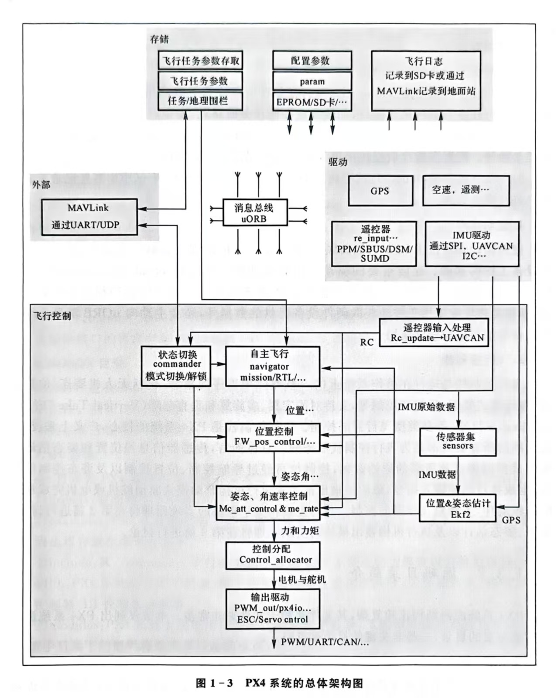

## 项目学习

最新官网 https://docs.px4.io/main/en/dev_setup/dev_env_linux_ubuntu

中文维基 https://www.bookstack.cn/read/TranslationPx4/1_Getting-Started-linux.md

旧版 https://docs.qgroundcontrol.com/master/en/qgc-user-guide/index.html


### 源代码

- PX4原生固件及其地面站网址

http://github.com/PX4

http://px4.io/

https://github.com/mavlink/qgroundcontrol

原生固件代码：C++，构架清晰，容易维护修改，多进程，目前来讲功能方面和细节不如ARM固件


- AutoPoilt固件及其地面站网址

…不用，所以省略了

APM代码：C++，稳定成熟，功能丰富，系统架构不如原生固件清晰， 维护起来比较难

- PIXHAWK控制硬件

https://github.com/PX4/Hardware


### pixhawk PX4FMU和PX4IO最底层启动过程分析

[pixhawk PX4FMU和PX4IO最底层启动过程分析_px4底层接口-CSDN博客](https://blog.csdn.net/csshuke/article/details/80536463)


## 飞控硬件架构

### PX4和Pixhawk 4

- PX4是一套无人机飞控软件系统

- Pixhawk 4 并不是一块运行 Ubuntu 的 Linux 计算机，而是一块以两个 STM32 微控制器为核心的飞控硬件。它运行 PX4 飞控软件，底层使用的是 NuttX 实时操作系统。


1. 飞控硬件（Flight Controller）

一块实际的电路板，通常包含 STM32 微控制器、传感器、电源管理芯片、通信接口和其他外围电路。


2. STM32 微控制器（MCU）

芯片内部有 CPU、Flash、RAM 和外设控制器。它负责执行机器指令、运算、访问传感器以及控制输出接口。


3. PX4 飞控软件

包括驱动、传感器处理、状态估计、飞行控制、通信等软件模块。它们经过编译后形成固件，运行在受支持的飞控处理器上。


1. STM32 是硬件处理器。
2. 飞控板是由处理器和外围电路组成的设备。
3. **PX4 是运行在飞控处理器上的软件系统**。
4. 你烧录的是编译好的固件，而不是把整个 PX4 源码直接复制到芯片中。


Pixhawk 系列飞控中常见的双处理器设计：一个主处理器 FMU，另一个是 I/O 处理器 PX4IO。


### FMU和I/O MCU

#### 主处理器：FMU

负责主要飞控计算

常见型号包括 STM32F4、F7、H7 系列，具体取决于飞控型号。

FMU 通常负责：

+ 运行 PX4 的主要飞控程序。
+ 读取和处理传感器数据。
+ 执行状态估计、姿态控制、位置控制等算法。
+ 运行 MAVLink 通信及其他软件模块。
+ 与 I/O 处理器或外围设备交换数据。
+ 


#### 辅助处理器：I/O MCU

主要负责专用输入输出

一些传统 Pixhawk 设计使用 STM32F100 或 STM32F103 等型号。

I/O 处理器主要负责部分实时输入输出工作，例如：

+ 接收遥控器输入。
+ 处理部分 PWM 输出。
+ 提供特定的输出控制和安全相关功能。
+ 与主处理器交换遥控器及输出控制信息。

具体功能取决于飞控设计与 PX4 配置，并不是每一块飞控都采用完全相同的分工。


#### 烧录

​	电脑上编译 PX4，生成固件，再通过 USB 等方式把固件写入飞控芯片（这里指的是FMU）的 Flash。

​	这里的 Flash 是芯片内部用于长期保存程序的非易失性存储器，断电后程序不会消失。RAM 则主要用于程序运行时保存变量、堆栈和临时数据。

​	对于 Pixhawk 4，可以把烧录过程理解成下面这样：

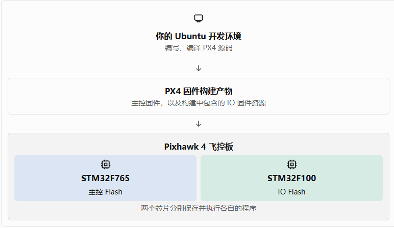

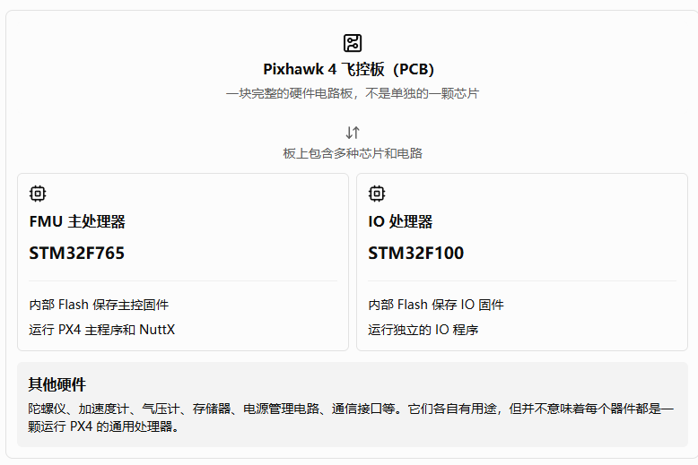

​	为什么一次烧录，两个 STM32 都可能更新了？

​	不是电脑通过 USB 直接同时给两颗 STM32 写程序，而是主控固件更新流程也负责处理 IO 固件的更新。主处理器通过出出暗扣给协处理器烧录程序。

大致过程如下：

1. 电脑编译 PX4

   编译主控固件，并根据构建配置把对应的 IO 固件纳入更新所需的资源中。

2. 电脑通过 USB 更新主控

   烧录工具与主控的引导程序（Bootloader）通信，将主控固件写入 STM32F765 的 Flash。

3. 主控启动 PX4

   STM32F765 启动主控程序，初始化硬件和相关驱动。

4. 主控检查 IO 固件

   PX4 的 IO 驱动可以通过连接主控和 IO 芯片的串行通信接口，与 STM32F100 通信，并在需要时执行 IO 固件更新。

5. IO 芯片运行自己的程序

   STM32F100 最终在自己的 Flash 中运行 IO 固件，独立处理分配给它的输入输出任务。

Pixhawk 4 的 UART8 对应 PX4IO 通信接口，主控和 IO 芯片通过板内连接进行通信。

需要注意两点：

+ 不是每次烧录都会重新更新 IO 固件。如果 IO 固件已经匹配，更新机制可能不需要再次写入。
+ 实际更新顺序和固件打包方式可能随 PX4 版本、引导程序及烧录工具有所不同。因此，上面描述的是整体机制，不代表每种烧录方式都严格执行相同步骤。


### NuttX

NuttX 是一个实时操作系统（RTOS），在 Pixhawk 4 上，它主要运行于 FMU 主处理器 STM32F765 上。

Pixhawk 4 是整块硬件板；FMU 是板上的主处理器及其相关功能体系；STM32F765 是实际执行指令的芯片；NuttX 则是运行在这颗芯片上的软件。PX4 官方文档也明确说明，Pixhawk 4 运行 PX4，底层使用 NuttX。


## 安装工具链

### linux环境

#### 打开用户串口设备访问权限

把用户添加到用户组　“dialout”:

```shell
sudo usermod -a -G dialout $USER
```

```shell
# 通过id或者groups指令验证用户组是否更新
id 
grouops
```

```shell
󰕈 zachery  ~   16:28  
 groups
zachery adm dialout cdrom sudo dip plugdev users lpadmin

󰕈 zachery  ~   16:28  
 id
uid=1000(zachery) gid=1000(zachery) 组=1000(zachery),4(adm),20(dialout),24(cdrom),27(sudo),30(dip),46(plugdev),100(users),114(lpadmin)

```

然后注销后，重新登录，因为重新登录后所做的改变才会有效。（我在使用时，注销后当前终端依然）

> 警告：永远不要使用`sudo`来修复权限问题，否则会带来更多的权限问题，需要重装系统来解决。


| PX4 的开发过程大致可以分成三个环节                           |
| ------------------------------------------------------------ |
| 1、 编写和编译 PX4 源码<br />在 Ubuntu 上使用 CMake、编译器等工具，把 C++ 源码编译成固件。通常不需要 `dialout` 权限。 |
| 2、 将固件烧录到飞控<br />电脑通过 USB 或其他接口与飞控通信。若烧录工具需要访问属于 `dialout` 组的串口设备，你就需要相应权限。 |
| 3、调试和连接飞控<br />例如，通过串口连接飞控、使用 MAVLink 工具通信，或进行某些硬件调试。这些操作可能需要串口读写权限。 |

​	`dialout` 是 Linux 系统中常见的一个用户组，加入这个组的用户通常可以访问具有相应组权限的串口设备。

​	这里有一个重要的前提：并不是加入 `dialout` 组，就自动拥有所有串口的访问权限，而是要看具体串口设备的权限配置。


#### 安装依赖包

环境包括：

+ Gazebo 模拟器（Gazebo Harmonic）  
+ 使用 Ubuntu 包管理器中的 gcc-arm-none-eabi 编译器，为 Pixhawk（及其他基于 NuttX 的硬件）构建工具链。

###### Simulation and NuttX (Pixhawk) Targets

​	使用 ubuntu.sh 脚本设置开发环境，以便为模拟器和/或 NuttX/Pixhawk 工具链进行构建。

> 源码中的环境配置脚本通常适用于较新的PX4版本。如果使用较旧版本的PX4，您可能需要获取与该版本对应的源代码。
>
>
> 连接 QGroundControl 查看固件
>
> 如果你手里的飞控可以正常连接电脑，建议先用这个方法，不需要先研究 PX4 源码。
>
> 1. 在电脑上安装并打开 QGroundControl。它是 PX4 常用的地面站软件。
> 2. 使用一根支持数据传输的 USB 线，将飞控连接到电脑。注意：有些 USB 线只能充电，不能传输数据。
> 3. 等待 QGroundControl 识别飞控，查看飞行器信息、固件信息或 Firmware 页面，确认当前固件版本。


1、[Download PX4 Source Code](https://docs.px4.io/main/en/dev_setup/building_px4):

```sh
git clone https://github.com/PX4/PX4-Autopilot.git --recursive
```

先下载源码，源码中有下载工具链的脚本文件

2、Run the **ubuntu.sh** with no arguments (in a bash shell) to install everything:


+ ```sh
  bash ./PX4-Autopilot/Tools/setup/ubuntu.sh
  ```

+ Acknowledge any prompts as the script progress.

+ You can use the `--no-nuttx` and `--no-sim-tools` options to omit the NuttX and/or simulation tools.

​	完成后重启计算机。

Once you have finished setting up the command-line toolchain:

+ Install [VSCode](https://docs.px4.io/main/en/dev_setup/vscode) (if you prefer using an IDE to the command line).
+ Install the [QGroundControl Daily Build](https://docs.px4.io/main/en/dev_setup/qgc_daily_build)


## 编译代码

### 编译软件仿真代码

在编译代码前，现在你的Ubuntu中下载QGC(必须是在px4源码运行的机器上，否则QGC连接不上)，并运行。

```sh
make px4_sitl gz_x500
```

| 程序     | 职责                                         |
| -------- | -------------------------------------------- |
| PX4 SITL | 执行飞控逻辑，接收命令并控制仿真无人机       |
| Gazebo   | 模拟无人机的运动和传感器环境，提供三维可视化 |
| QGC      | 提供地面站界面，通过 MAVLink 与飞控通信      |

PX4 SITL 与 QGC 通常通过 UDP 传输 MAVLink 消息。MAVLink 是通信协议，UDP 是传输方式。在常见的 PX4 SITL 默认配置中，PX4 会通过 UDP 向地面站发送数据，QGC 监听相应通信端口并自动发现飞控。

等make通过，就可以仿真验证飞行、降落等功能

在PX4提示符后（pxh>）输入：

```
# 起飞
pxh> commander takeoff
```

```
# 降落
pxh> commander land
```

stopped by doing **CTRL+C** (or by entering `shutdown`).

### 编译硬件代码


进入项目文件夹编译：

```sh
cd PX4-Autopilot
make px4_fmu-v5_default
```


烧录程序：

Append `upload` to the make commands to upload the compiled binary to the autopilot hardware via USB. For example

```sh
make px4_fmu-v5_default upload
```


### PX4 Make Build Targets


前面的章节展示了如何调用 make 来构建多种不同的目标、启动模拟器、使用集成开发环境等。本节将介绍如何构造 make 的选项，以及如何查找可用的选项。

使用特定配置和初始化文件调用 make 的完整语法如下：

```sh
make [VENDOR_][MODEL][_VARIANT] [VIEWER_MODEL_DEBUGGER_WORLD]
```

**VENDOR_MODEL_VARIANT**: (also known as `CONFIGURATION_TARGET`)

- VENDOR：板子制造商，如 px4、aerotenna、airmind、atlflight、auav、beaglebone、intel、nxp 等。Pixhawk 系列板子的厂商名称为 px4。
- MODEL：板子型号，例如 sitl、fmu-v2、fmu-v3、fmu-v4、fmu-v5、navio2 等。
- VARIANT：用于指定特定配置，例如` bootloader`、`cyphal、 `sih，这些会添加或移除 `default`（默认)配置中的组件。通常情况下，此参数可省略，即默认配置。

您可以使用以下命令获取所有可用的 CONFIGURATION_TARGET 选项列表：

```sh
make list_config_targets
```


**VIEWER_MODEL_DEBUGGER_WORLD:**

**VIEWER**：这是要启动并连接的模拟器（“viewer”）：gz、gazebo、none

提示

如果要启动 PX4 并等待模拟器（如 Gazebo、Gazebo Classic 或其他模拟器）运行，则不能使用 none。例如，px4_sitl none_iris 会启动 PX4 而不使用模拟器（但使用 iris 飞行器模型）。

**MODEL**(模型)：指定要使用的车辆模型（例如 iris（默认）、rover、tailsitter 等），该模型将由模拟器加载。环境变量 PX4_SIM_MODEL 将被设置为所选模型，并在启动脚本中用于选择适当的参数。

**DEBUGGER**(调试器)：使用的调试器：none（默认）、ide、gdb、lldb、ddd、valgrind、callgrind。更多信息请参见模拟调试。

**WORLD**(世界0：（仅适用于 Gazebo Classic）。设置要加载的世界文件（位于 PX4-Autopilot/Tools/simulation/gazebo-classic/sitl_gazebo-classic/worlds）。默认值为空.world。更多信息请参见 Gazebo Classic > 加载特定世界。

## QGroundControl Guide

​	QGroundControl 为使用 PX4 或 ArduPilot 的飞行器提供完整的飞行控制和车辆设置功能。它对初学者操作简便，同时为经验丰富的用户提供了高端的功能支持。

​	主要特点：

1. ArduPilot 和 PX4 驱动车辆的完整设置与配置。  
2. 自主飞行任务规划。  
3. 飞行地图显示，包含车辆位置、飞行轨迹、航点及仪表信息。  
4. 支持视频流传输，并在仪表上叠加显示内容。  
5. 支持使用摇杆和游戏手柄直接控制车辆。  
6. 支持管理多架车辆。  
7. 可下载飞行日志、地理标记、MAVLink 控制台以及 MAVLink 交通检查功能。  
8. 支持 Windows、macOS、Linux、Android 和 iOS 系统。


下载QGC

[QGC下载]:https://docs.qgroundcontrol.com/master/en/qgc-user-guide/getting_started/ui_overview.html


注意：

- 启用串口访问：将您的用户添加到拨出组，以便无需 root 权限即可与 USB 设备通信。

```
sudo usermod -aG dialout "$(id -un)"
```

- Ubuntu 默认自带一个串行调制解调器管理器，会干扰与机器人相关的串行端口（或USB串行）使用。在安装 QGroundControl 之前，应先卸载该调制解调器管理器，并授予自己访问串行端口的权限。

```
# preferred: stop and mask the service
sudo systemctl mask --now ModemManager.service

# or, if you’d rather remove the package
sudo apt remove --purge modemmanager
```

然后执行：

```
sudo apt install -y libfuse2 libxcb-xinerama0 libxkbcommon-x11-0 libxcb-cursor0
```

**To install \*QGroundControl\*:**

1. Download the AppImage for your architecture:
   + [Linux x86_64](https://d176tv9ibo4jno.cloudfront.net/builds/master/QGroundControl-x86_64.AppImage)
   + [Linux aarch64](https://d176tv9ibo4jno.cloudfront.net/builds/master/QGroundControl-aarch64.AppImage)
2. Make the AppImage executable

```
chmod +x QGroundControl-<arch>.AppImage
```

1. Run QGroundControl Either double-click the AppImage in your file manager or launch it from a terminal:

```
./QGroundControl-<arch>.AppImage
```


QGC软件中提供了MAVlink控制台，使用方法和效果和在终端（px4>）中是一样的。

```sh
# 查看命令
help
```


```sh
nsh> commander start
ERROR [module] Task already running
nsh> commander stop
nsh> commander start
WARN  [health_and_arming_checks] Preflight: Strong magnetic interference
WARN  [health_and_arming_checks] Preflight: Strong magnetic interference
nsh> commander start
ERROR [module] Task already running
```


实现源码在 `/home/zachery/PX4-Autopilot/platforms/common/module_base.cpp`

```c++
//module_base.cpp
int ModuleBase::main(Descriptor &desc, int argc, char *argv[])
{
	if (argc <= 1 ||
	    strcmp(argv[1], "-h")    == 0 ||
	    strcmp(argv[1], "help")  == 0 ||
	    strcmp(argv[1], "info")  == 0 ||
	    strcmp(argv[1], "usage") == 0) {
		return desc.print_usage(nullptr);
	}

	if (strcmp(argv[1], "start") == 0) {
		// Pass the 'start' argument too, because later on px4_getopt() will ignore the first argument.
		return start_command(desc, argc - 1, argv + 1);
	}

	if (strcmp(argv[1], "status") == 0) {
		return status_command(desc);
	}

	if (strcmp(argv[1], "stop") == 0) {
		return stop_command(desc);
	}

	pthread_mutex_lock(&px4_modules_mutex);
	int ret = desc.custom_command(argc - 1, argv + 1);
	pthread_mutex_unlock(&px4_modules_mutex);

	return ret;
}


int ModuleBase::status_command(Descriptor &desc)
{
	int ret = -1;
	pthread_mutex_lock(&px4_modules_mutex);

	if (is_running(desc) && desc.object.load()) {
		ModuleBase *object = desc.object.load();
		ret = object->print_status();

	} else {
		PX4_INFO("not running");
	}

	pthread_mutex_unlock(&px4_modules_mutex);
	return ret;
}
```


## 源码框架

不同版本的源码的框架存在很大的差别。

PX4 是一个持续迭代的开源项目。不同版本之间，源码可能发生以下变化：

+ 文件夹被重命名或移动。

+ 原本放在一个目录中的代码被拆分到多个目录。

+ 多个模块被整合，或者一个模块被拆分。

+ 驱动、通信协议和硬件适配代码的组织方式发生变化。

+ 构建系统从旧配置迁移到新配置。

  

为了学习PX4的源码框架，我将不同教程的代码框架讲解杂糅到一起，重点学习重要和共有的目录。

```sh
drwxrwxr-x 50 zachery zachery  4096 10月 19 17:39 boards/
drwxrwxr-x  4 zachery zachery  4096 10月 26 14:34 build/
drwxrwxr-x  2 zachery zachery  4096 10月 19 17:39 cmake/
drwxrwxr-x 11 zachery zachery  4096 10月 19 17:39 docs/
drwxrwxr-x  2 zachery zachery  4096 10月 19 17:39 launch/
drwxrwxr-x  5 zachery zachery 12288 10月 19 17:39 msg/
drwxrwxr-x  7 zachery zachery  4096 10月 19 17:39 platforms/
drwxrwxr-x  5 zachery zachery  4096 10月 19 17:39 posix-configs/
drwxrwxr-x  6 zachery zachery  4096 10月 19 17:39 ROMFS/
drwxrwxr-x  9 zachery zachery  4096 10月 19 17:39 src/
drwxrwxr-x  2 zachery zachery  4096 10月 19 17:39 srv/
drwxrwxr-x  5 zachery zachery  4096 10月 23 15:15 test/
drwxrwxr-x  2 zachery zachery  4096 10月 19 17:39 test_data/
drwxrwxr-x 29 zachery zachery  4096 10月 19 17:39 Tools/
drwxrwxr-x  2 zachery zachery  4096 10月 19 17:39 validation/

```


### boards

boards文件夹中是各个品牌、版本的飞控板的编译脚本，其中px4文件夹装的是pixhawk的原生固件的编译脚本。


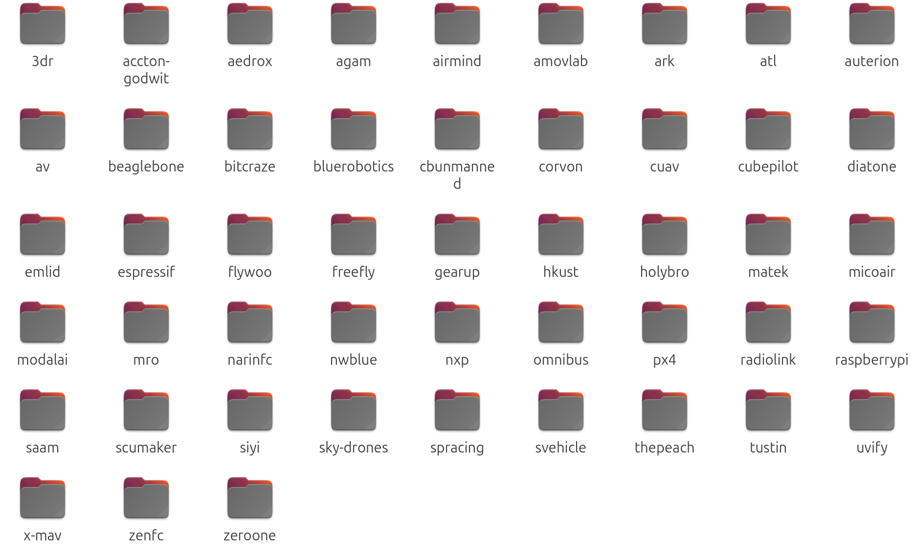


进入px4文件夹，内部是pixhawk的不同版本，我使用的是pixhawk v5x版本对应fmu-v5文件夹。

`boards/px4/fmu-v5/` 并不是 PX4 全部功能代码所在的目录，而是针对 FMUv5 这一类硬件平台的定制目录。PX4 的通用模块和驱动主要位于其他目录，构建 FMUv5 固件时，再根据板级配置选择需要编译的部分，并加入特定的硬件初始化和启动逻辑。


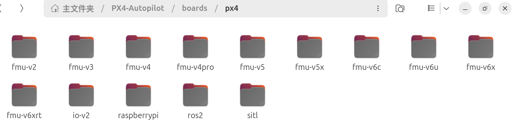

进入fmu-v5文件夹

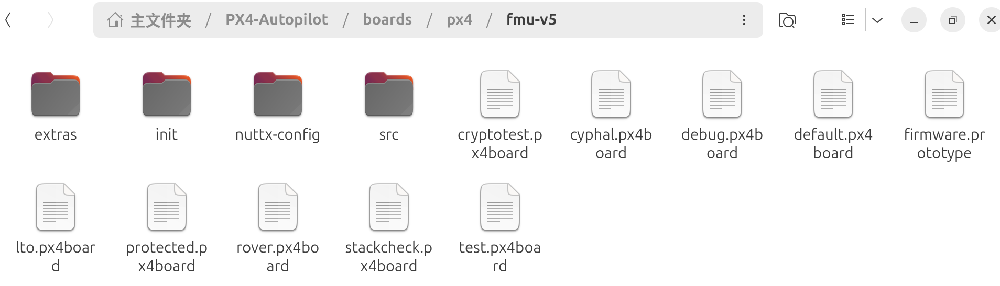


-  `.px4board` 文件是板级配置文件，不同的板级配置文件对应不同的编译命令，也会生成不同的编译文件。**定义该板级构建配置启用哪些模块、驱动和功能**。例如，是否编译某个传感器驱动或飞行控制模块。

-  `nuttx-config/` 存放与 NuttX 实时操作系统有关的配置，例如内核选项和板级系统设置。
-  `src/` 和` extras/` 包含与该板级目标有关的源码或额外配置，具体内容需要进一步查看子目录。
-  `init/` 包含板级启动脚本(存放飞控启动时执行的脚本)等文件，影响 PX4 启动后如何初始化硬件、启动模块和配置系统。


| 配置文件              | 对应命令                     |
| --------------------- | :--------------------------- |
| `default.px4board`    | `make px4_fmu-v5_default`    |
| `debug.px4board`      | `make px4_fmu-v5_debug`      |
| `cryptotest.px4board` | `make px4_fmu-v5_cryptotest` |
| `cyphal.px4board`     | `make px4_fmu-v5_cyphal`     |
| `lto.px4board`        | `make px4_fmu-v5_lto`        |
| `protected.px4board`  | `make px4_fmu-v5_protected`  |
| `rover.px4board`      | `make px4_fmu-v5_rover`      |
| `stackcheck.px4board` | `make px4_fmu-v5_stackcheck` |
| `test.px4board`       | `make px4_fmu-v5_test`       |

#### .px4board ：决定固件编译哪些功能


以`default.px4board`为例，它本质上是一份板级功能配置清单，告诉 PX4 的构建系统：针对 FMUv5 的默认固件，应该启用哪些驱动、模块和系统命令。


例如 

```
CONFIG_BOARD_TOOLCHAIN="arm-none-eabi"
CONFIG_BOARD_ARCHITECTURE="cortex-m7"
CONFIG_ARCH_CHIP_STM32F7=y
```

这几行说明了三个不同层面的信息：

| 配置项                       | 含义                                |
| :--------------------------- | ----------------------------------- |
| `CONFIG_BOARD_TOOLCHAIN`     | 指定使用 ARM 嵌入式交叉编译工具链   |
| `CONFIG_BOARD_ARCHITECTURE`  | 指定目标处理器架构为 Cortex-M7      |
| `CONFIG_ARCH_CHIP_STM32F7=y` | 启用 STM32F7 系列芯片相关的构建配置 |

里的 `y` 可以理解为“启用”。但它不是说这些模块的源码都存放在 `default.px4board` 中，而是告诉构建系统将对应功能纳入本次固件构建。


| 配置                         | 对应作用                         |
| ---------------------------- | -------------------------------- |
| `CONFIG_MODULES_MAVLINK=y`   | MAVLink 通信模块                 |
| `CONFIG_MODULES_COMMANDER=y` | 飞行状态、命令和安全检查相关逻辑 |
| `CONFIG_MODULES_EKF2=y`      | 状态估计模块 EKF2                |
| `CONFIG_MODULES_SENSORS=y`   | 传感器处理模块                   |
| `CONFIG_DRIVERS_GPS=y`       | GPS 驱动功能                     |
| `CONFIG_DRIVERS_PX4IO=y`     | PX4IO 相关驱动功能               |
| `CONFIG_SYSTEMCMDS_PARAM=y`  | 参数管理相关命令                 |
| `CONFIG_SYSTEMCMDS_UORB=y`   | uORB 相关系统命令                |

这些模块的具体实现不在这个配置文件里。例如，`CONFIG_MODULES_MAVLINK=y` 并不意味着 MAVLink 源码就在 `boards/px4/fmu-v5/` 下面。你需要进一步去通用源码目录中找对应实现。

另外，你的配置中启用了 `CONFIG_MODULES_SIMULATION_SIMULATOR_SIH=y`，这并不意味着固件只能用于仿真；它表示相应的仿真模块被纳入了这份固件配置。


#### src/：FMUv5 专属的板级硬件代码

```sh
src/
├── init.c
├── manifest.c
├── i2c.cpp
├── timer_config.cpp
├── board_config.h
├── sdio.c
├── spi.cpp
├── can.c
├── usb.c
├── led.c
├── CMakeLists.txt
├── toc.c
└── stm32_userspace.c
```


`src/` 包含板级初始化、硬件资源配置等代码。


- `board_config.h`：板级硬件配置入口之一。
  这个文件通常会定义或汇总板级硬件配置，例如硬件接口、引脚、总线、LED 等相关定义。之前使用 STM32CubeMX 和 HAL 开发时，习惯从 GPIO 初始化、外设初始化函数入手。PX4 的板级代码也要解决类似问题，但组织方式不完全相同：具体配置可能分散在头文件、板级源文件和 NuttX 配置中。


- `init.c`：板级初始化代码 

  这个文件属于 FMUv5 专属的 C 源码。它可能参与早期板级初始化，但不能只凭文件名就断言它负责初始化所有外设。

  在阅读时，可以重点寻找：

  1. 初始化函数的名称和调用顺序；
  2. 是否存在 GPIO、外设电源或板级资源配置；
  3. 哪些函数由 PX4 启动流程调用；
  4. 哪些功能已经交给 NuttX 或其他板级代码完成。

  

- `spi.cpp`、`i2c.cpp`、`can.c`、`usb.c`：硬件接口相关代码

  这些文件分别与 SPI、I²C、CAN、USB 等接口有关。你可以先把它们作为入口，再追踪实际的初始化函数。

  例如，你想研究 IMU 传感器，可以沿着以下思路走：

  1. 在 `default.px4board` 中确认启用了哪些 IMU 驱动。
  2. 到 `src/drivers/` 或其他实际驱动源码目录中寻找对应驱动。
  3. 查看驱动如何访问 SPI 或 I²C。
  4. 再追踪 FMUv5 如何配置相应总线、片选信号及相关硬件资源。

  

-  `CMakeLists.txt`：告诉构建系统如何编译板级代码

   这是你已经学过的 CMake 知识与 PX4 源码之间的连接点。

   它通常负责声明当前目录需要参与构建的源文件、依赖关系或其他构建配置。你可以通过阅读它，确认 `src/` 下的哪些文件真正参与了当前固件的编译。

   不要因为某个 `.c` 或 `.cpp` 文件存在于目录中，就认为每次构建都会编译它；是否纳入构建，要看构建规则和对应配置。


#### init/：飞控启动脚本


 一、`rc.board_defaults`：启动时设置板级默认参数

这个文件的作用不是编译驱动，而是在启动过程中设置与 FMUv5 硬件有关的默认参数，并启动部分板载功能。

1. `param set-default` 不等于强制设置参数

例如：

```
param set-default BAT1_V_DIV 18.1
param set-default BAT2_V_DIV 18.1
```

这两条命令为电池电压测量相关参数设置默认值。

这里的关键是 `set-default`：它用于设置默认值，而不是无条件覆盖用户已经保存的参数。这样设计的原因是，飞控每次开机时都需要加载板级默认配置，但又不能因此把用户通过 QGroundControl 调整的参数全部覆盖掉。

```
param set-default BAT1_A_PER_V 36.367515152
param set-default BAT2_A_PER_V 36.367515152
```

它们涉及电流测量的比例系数。具体数值和测量电路有关，因此不要将其直接照搬到其他飞控硬件上。

2. `ver hwtypecmp`：根据硬件型号区分配置

```
if ver hwtypecmp V5005000 V5005002 V5006000 V5006002
then
    param set-default EKF2_MULTI_IMU 3
    param set-default SENS_IMU_MODE 0
else
    param set-default EKF2_MULTI_IMU 2
    param set-default SENS_IMU_MODE 0
fi
```

这段代码根据硬件类型决定 `EKF2_MULTI_IMU` 的默认值：

+ 匹配列出的硬件类型时，将默认值设为 `3`；
+ 其他硬件类型则设为 `2`。

注释说明，列出的部分 CUAV V5+、V5nano 型号具有三个 IMU，因此配置支持多 IMU 的 EKF 使用场景。

这里要区分两件事：

+ `EKF2_MULTI_IMU`：与 EKF2 使用多个 IMU 的配置有关。
+ `SENS_IMU_MODE`：与传感器模块的 IMU 处理模式有关。

设置 `EKF2_MULTI_IMU=3` 不等于启动了三个 IMU 驱动。 参数配置、驱动启动、传感器数据是否被识别，是三个不同层次的问题。

3. 启动板载 LED 和安全按钮功能

```
rgbled_pwm start
safety_button start
```

这两条命令启动相应的 PX4 功能模块。前者与 PWM RGB LED 控制有关，后者与安全按钮功能有关。

它们和上面的 `param set-default` 不同：前者是启动命令，后者是参数设置命令。


 二、`rc.board_sensors`：真正启动板载传感器驱动

这部分对你研究 PX4 硬件最重要。

先看开头：

```
board_adc start
```

它启动板级 ADC 驱动，用于相应模拟量采集功能。之后的脚本开始启动 IMU、气压计和磁力计等传感器驱动。

1. 根据硬件型号选择不同的 IMU 驱动

```
if ver hwtypecmp V5005002 V5006002
then
    icm42688p -s -R 2 -q start
else
    icm20602 -s -R 2 -q start
fi
```

这段代码表示：对特定硬件型号，启动 ICM-42688-P 驱动；否则启动 ICM-20602 驱动。

它体现了 PX4 板级适配的一种常见思路：

通用驱动代码可以存在于同一个 PX4 工程中，但具体哪一个驱动在某块板子上启动，可以由板级启动脚本决定。

这也解释了为什么你在源码中找到很多 IMU 驱动，并不意味着你的飞控会在运行时启动所有这些驱动。

2. 启动其他 IMU 和气压计

接下来：

```
icm20689 -s -R 2 start

bmi055 -A -R 2 -s start
bmi055 -G -R 2 -s start

ms5611 -s start
```

从命令名称可以识别出：

| 命令        | 设备或功能          |
| ----------- | ------------------- |
| `icm20689`  | ICM-20689 IMU 驱动  |
| `bmi055 -A` | BMI055 加速度计部分 |
| `bmi055 -G` | BMI055 陀螺仪部分   |
| `ms5611`    | MS5611 气压计驱动   |

其中 `-A` 和 `-G` 用来选择 BMI055 驱动的不同传感器部分。具体每个命令行选项的精确定义，应继续查看对应驱动的参数解析代码或帮助信息。

这里还要注意：脚本中写了启动命令，并不保证传感器一定启动成功。设备是否存在、总线是否正常、驱动是否成功初始化，都可能影响最终结果。

3. 启动内部和外部磁力计

```
ist8310 -I -R 10 start
```

注释说明这是内部磁力计。

而：

```
ist8310 -X -b 1 -R 10 start
```

对应外部磁力计，注释中指出它连接在 GPS1/I²C1 相关总线上。

所以这里的 `-I` 和 `-X` 是区分内部、外部设备使用场景的重要线索；`-b 1` 则与总线选择有关。要确认它们在当前源码版本中的精确定义，需要检查 `ist8310` 驱动的命令行解析实现。

 三、谁来执行这两个启动脚本？

你的 `grep` 结果已经给出了关键线索：

```
ROMFS/px4fmu_common/init.d/rcS:276
ROMFS/px4fmu_common/init.d/rcS:278
ROMFS/px4fmu_common/init.d/rcS:420
ROMFS/CMakeLists.txt:198
ROMFS/CMakeLists.txt:199
```

这说明启动脚本不是孤立存在的，而是被 PX4 的通用启动流程和 ROMFS 构建配置引用。

1. `rcS` 是启动流程中的关键脚本

你的结果显示，`ROMFS/px4fmu_common/init.d/rcS` 中设置了 `BOARD_RC_DEFAULTS` 和 `BOARD_RC_SENSORS` 变量。结合变量名称，可以看出启动流程会安排板级默认参数脚本和板级传感器脚本。

不过，变量赋值本身不等于执行。我们还需要查看后面的条件判断和调用语句，才能确认它们何时执行、执行顺序是什么。

2. `ROMFS/CMakeLists.txt` 负责把脚本纳入固件文件系统

你可以将 ROMFS 理解为 PX4 固件中所包含的一组运行时文件，启动脚本就是其中的一部分。


### build

build文件夹是编译目标目录，只有经过至少一次编译才会生成此文件夹，内部存放的是源码经过编译生成的编译选项、中间文件、目标文件等。编译不同版本的固件会生成不同的文件夹。


比如px4_fmu-v2_default就是make px4_fmu-v2_default命令编译生成的，用于飞控板的。

px4_sitl_default就是make px4_sitl_default命令编译生成的，用于jMAVSim仿真或gazebo仿真。


### cmake


cmake文件夹是cmake编译工具的相关文件，在开发中这个文件夹中的文件不需要修改。


### docs

开发者文档目录，包括代码说明等。


### launch

launch文件夹是仿真环境用到的文件，在gazebo中生成世界，配置ros节点等。


### msg

存放UORB消息主题的地方，实现PX4各进程之间通信就是用这些message。我们可以在这个文件夹内定义自己的message。如果要二次开发添加消息主题，就在这个文件夹里面添加修改。

这里存放的是各种消息脚本文件（`.msg`）每一个`.msg`文件对应一个消息结构体。系统在编译过程中会调用./tool目录下的python脚本 px_generate_uorb_topic_files.py 读取消息定义的内容，并根据预定义的模块生成与消息同名的C/C++头/源码文件。

- 头文件位于 ` ./build/xxx/uORB/topic`
- 源文件位于 `./build/xxx/msg/topic_source`


### Romfs

文件系统文件夹，存放飞控系统的启动脚本，如果修改启动脚本主要是在这个文件夹里。Romfs/px4fmu_common/init.d ,如 rcS 主要的启动脚本，还有其他的rc.xxx的脚本，传感器脚本，参数脚本等等，反正负责系统初始化的，如果自己定写了个功能模块要随系统启动就在这里添加和启动。


ROM file system的缩写，是文件系统文件夹，里面存放的飞控系统的启动脚本，负责系统初始化。

内部的 `px4fmu_common `文件夹中的 ` init.d ` 是关于 px4 系统初始上电启动的启动脚本，即一系列的启动过程和系统配置。其中较为重要的部分在如下目录下：

```
Firmware\ROMFS\px4fmu_common\init.d
```

如文件 `rcS、rc.logging、rc.mc_apps、rc.sensors`等

`rcS`：最先启动的脚本，负责挂载SD卡、启动uORB、配置系统参数等。

`rc.logging`：日志配置和启动代码。

`rc.sensors：sensors`驱动启动代码。

`rc.mc_apps`：启动上层应用（src/modules 中的模块均在此启动），如 attitude_estimate 、 attitude_control 、position_estimate 和 position_control 等。

### platforms

系统平台实现的文件，包括PX4采用的Nuttx操作系统的源代码。

```sh
󰕈 zachery  …/PX4-Autopilot/platforms   main   16:57  
 ll
总计 36
drwxrwxr-x  7 zachery zachery 4096 10月 19 17:39 ./
drwxrwxr-x 23 zachery zachery 4096 10月 26 14:53 ../
-rw-rw-r--  1 zachery zachery 1725 10月 19 17:39 CMakeLists.txt
drwxrwxr-x  6 zachery zachery 4096 10月 19 17:39 common/
-rw-rw-r--  1 zachery zachery   74 10月 19 17:39 Kconfig
drwxrwxr-x  7 zachery zachery 4096 10月 19 17:39 nuttx/
drwxrwxr-x  6 zachery zachery 4096 10月 19 17:39 posix/
drwxrwxr-x  5 zachery zachery 4096 10月 19 17:39 qurt/
drwxrwxr-x  5 zachery zachery 4096 10月 19 17:39 ros2/

```


### Src

src是源代码目录，是PX4的核心，非常重要


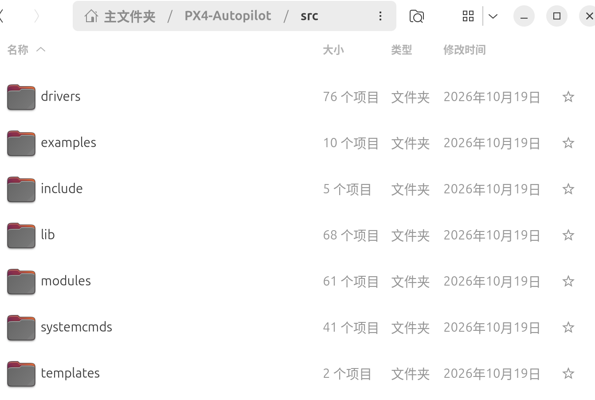


1. `drivers ` :是pixhawk 硬件系统中使用的所有传感器的驱动代码，包括陀螺仪、加速度计、磁力计、气压计、GPS、光流等，也包括pwm输出、px4io控制、不同遥控器通信协议等功能的驱动。

2. `examples`: 是实例文件夹，入门 PIXHAEK开发的一些很好的例子就在里面，其中最经典的是px4_simple_app 这个例子，要搞明白进程间通信UORB就是这个例子。

3. `modules `: 功能模块文件夹，也是二次开发主要的文件夹，包括姿态解算，姿态控制，位置估计，位置控制，指令控制，落地检测，传感器初始化等。

   - attitude_estimator_q：使用 mahony 互补滤波算法实现姿态结算。

   - commander：整个系统的过程实现，包括起飞前各传感器的校准、安全开关是否使能、飞行模式切换、pixhawk硬件上指示灯颜色定义等。

   - ekf2：使用扩展卡尔曼滤波器算法实现姿态和位置结算。

   - fw_att_control：固定翼飞机的姿态控制。

   - fw_pos_control_l1：固定翼飞机的位置控制器。

   - land_detector：使用land飞行模式降落的落地监测部分。

   - local_position_estimator：LPE 算法实现位置解算。

   - logger：关于 log 日志的读写函数。

   - mavlink：和地面站通信的通信协议。

   - mc_att_control：姿态控制的算法实现，主要就是姿态的内外环 PID 控制，外环角度控制、内环角速度控制。

   - mc_pos_control：位置控制的算法实现，主要就是位置的内外环 PID 控制，外环速度控制、内环加速度控制。

   - navigator：任务，失效保护和RTL导航仪。

   - sensors：关于各种传感器的相关函数。

   - vtol_att_control：垂直起降姿态控制器。

4. `systemcmds`:  是系统指令文件夹，都是飞控的支持的命令源码。比如top命令，reboot命令等等，这些命令都是可以在终端操作的。这一部分属于调试开发内容

5. `include`: include文件夹是其他代码需要用到的头文件和库。

6. `lib` : 标准库，有矩阵运算、PID控制、传感器校准等。

7. `templates` : templates文件夹中是存放功能模块的代码模板，可以用于参考。


### Tools

Tools文件夹下是一些工具，比如下载工具、仿真环境等。


## PX4 Git管理

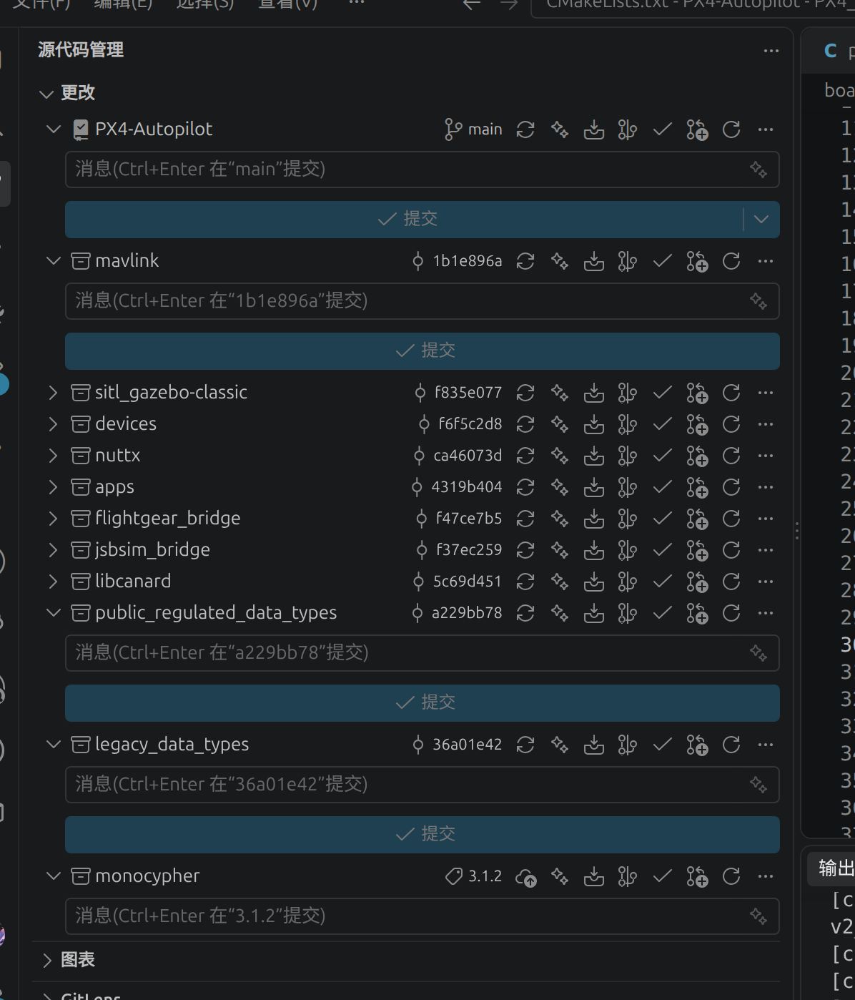


PX4-Autopilot 源码并不是由一个 Git 仓库统一管理所有文件，而是采用了 Git 主仓库 + 多个 Git 子模块（Git submodules） 的管理方式。

1. 主仓库：PX4-Autopilot

分支：`main`

这是 PX4 的主 Git 仓库，负责管理飞控应用、板级配置、构建系统以及各个子模块的引用关系。你在主仓库修改的普通源码文件，通常由这个仓库跟踪。

2. 子仓库：`mavlink`、`nuttx`、`devices` 等

它们不是普通的主仓库目录，而是独立的 Git 仓库，拥有自己的提交历史和版本信息。截图中，`mavlink` 显示提交 `1b1e896a`，`nuttx` 显示 `ca46073d`，说明各自有对应的当前提交。

3. 每个仓库都有独立的提交入口

例如，你在 `mavlink` 中修改代码，可以在 `mavlink` 仓库提交；修改 PX4 根目录下的 `boards/` 文件，则通常在 `PX4-Autopilot` 主仓库提交。两个仓库的提交不会自动合并成同一个提交。


PX4 使用子模块，是为了让飞控主程序和外部依赖库能够分别维护版本。官方文档明确说明，NuttX、MAVLink 等组件通过 Git 子模块引入。

| 截图中的目录                  | 大致作用                | 管理方式   |
| ----------------------------- | ----------------------- | ---------- |
| `PX4-Autopilot`               | 飞控主工程              | 主仓库     |
| `mavlink`                     | 无人机通信协议相关代码  | 独立子模块 |
| `nuttx`                       | 飞控使用的 RTOS 内核    | 独立子模块 |
| `apps`                        | NuttX 应用组件          | 独立子模块 |
| `devices`                     | GPS 设备相关代码        | 独立子模块 |
| `sitl_gazebo-classic`         | Gazebo Classic 仿真桥接 | 独立子模块 |
| `jsbsim_bridge`               | JSBSim 仿真桥接         | 独立子模块 |
| `libcanard`                   | Cyphal 相关通信库       | 独立子模块 |
| `public_regulated_data_types` | Cyphal 相关数据类型     | 独立子模块 |
| `legacy_data_types`           | 旧版数据类型组件        | 独立子模块 |
| `monocypher`                  | 密码学库                | 独立子模块 |

说明：表格根据目录名称和 PX4 官方子模块配置说明整理。截图中的 `apps` 等目录可能显示为子模块的嵌套仓库；其具体身份可通过后面的命令确认。

你可以把这种结构理解成一个软件工程团队：

+ 主仓库负责决定使用哪些依赖，以及依赖的具体版本。
+ 子仓库负责维护各自的源代码和提交历史。
+ 构建系统将主仓库和指定版本的子模块组合起来，编译成最终固件。


## 编写第一个应用程序


在本节中，我们将创建一个简单的应用程序，仅打印出“Hello Sky!”。该程序包含一个单个 C 文件和一个 CMake 定义（用于告诉工具链如何构建应用程序）。


1. Create a new directory **PX4-Autopilot/src/examples/px4_simple_app**.
2. Create a new C file in that directory named **px4_simple_app.c**:

- 在C文件中编写下面的代码：

- ```c
  /**
   * @file px4_simple_app.c
   * Minimal application example for PX4 autopilot
   *
   * @author Example User <mail@example.com>
   */
  
  #include <px4_platform_common/log.h>
  /**
   * @brief 测试应用程序的主函数
   * @param argc 命令行参数的数量，包括应用程序自身路径和程序名
   * @param argv 命令行参数的数组，字符串指针数组类型的参数向量，数组中每一个元素指向命令行中的一个命令字符串
   * @return 0 表示成功，非0表示失败
   * @note PX4 系统所基于的编译器语法规则比较严格，因此在编写代码之前，必须生命该函数不然会报错
   * @note 该函数使用了 extern "C" 声明，以确保在 C++ 编译器中使用 C 链接方式，避免名称修饰问题
   * @note __EXPORT 声明的函数一般作为应用程序的入口函数，且必须采用 <module_name>_main 的命名方式
   */
  extern "C" __EXPORT int px4_simple_app_main(int argc, char *argv[]);
  
  int px4_simple_app_main(int argc, char *argv[])
  {
  	PX4_INFO("Hello Sky!");
  	return OK;
  }
  ```
  
  > 主函数必须命名为 ` <module_name>_main` ，并如所示从模块中导出。
  
  > `PX4_INFO` 是 PX4 shell 中的 printf 对应函数（来自 px4_platform_common/log.h）。日志级别有多种：`PX4_INFO` 、`PX4_WARN`、`PX4_ERR` 、`PX4_DEBUG` 。警告和错误信息还会被添加到 ULog 中，并显示在[Flight Review](https://logs.px4.io/).。

3. 创建并打开一个名为 CMakeLists.txt 的新 CMake 定义文件。将以下文本复制进去：

- ```
  px4_add_module(
  	MODULE examples__px4_simple_app
  	MAIN px4_simple_app
  	STACK_MAIN 2000
  	SRCS
  		px4_simple_app.c
  	DEPENDS
  	)
  ```

`px4_add_module() ` 方法根据模块描述生成一个静态库。

+ MODULE 块是固件中模块的唯一名称（通常，模块名称会通过父目录前缀到 src 目录）。 

+ MAIN 块列出了模块的入口点，用于将命令注册到 NuttX 中，以便从 PX4 shell 或 SITL 控制台调用。

  > The `px4_add_module()` format is documented in [PX4-Autopilot/cmake/px4_add_module.cmake](https://github.com/PX4/PX4-Autopilot/blob/main/cmake/px4_add_module.cmake).
  >
  > ```cmake
  > #=============================================================================
  > #
  > #	px4_add_module
  > #
  > #	This function builds a static library from a module description.
  > #
  > #	Usage:
  > #		px4_add_module(MODULE <string>
  > #			MAIN <string>
  > #			[ STACK_MAIN <string> ]
  > #			[ STACK_MAX <string> ]
  > #			[ COMPILE_FLAGS <list> ]
  > #			[ INCLUDES <list> ]
  > #			[ DEPENDS <string> ]
  > #			[ SRCS <list> ]
  > #			[ MODULE_CONFIG <list> ]
  > #			[ EXTERNAL ]
  > #			[ DYNAMIC ]
  > #			)
  > #
  > #	Input:
  > #		MODULE			: unique name of module
  > #		MAIN			: entry point
  > #		STACK			: deprecated use stack main instead
  > #		STACK_MAIN		: size of stack for main function
  > #		STACK_MAX		: maximum stack size of any frame
  > #		COMPILE_FLAGS		: compile flags
  > #		LINK_FLAGS		: link flags
  > #		SRCS			: source files
  > #		MODULE_CONFIG		: yaml config file(s)
  > #		INCLUDES		: include directories
  > #		DEPENDS			: targets which this module depends on
  > #		EXTERNAL		: flag to indicate that this module is out-of-tree
  > #		DYNAMIC			: don't compile into the px4 binary, but build a separate dynamically loadable module (posix)
  > #		UNITY_BUILD		: merge all source files and build this module as a single compilation unit
  > #
  > #	Output:
  > #		Static library with name matching MODULE.
  > #		(Or a shared library when DYNAMIC is specified.)
  > #
  > #	Example:
  > #		px4_add_module(MODULE test
  > #			SRCS
  > #				file.cpp
  > #			STACK_MAIN 1024
  > #			DEPENDS
  > #				git_nuttx
  > #			)
  > #
  > 
  > # example:
  > px4_add_module(
  > 	MODULE examples__test_app	#模块名。命名规则：通过“__”（这里是两个下划线）分割文件路径。起始路径是./src 无需给出.
  > 	MAIN test_app             	#主函数名。用于确定程序的主函数。命名规则：主函数名去掉"_main"后缀。这里是test_app_main.cpp，所以主函数名是test_app。	
  > 	COMPILE_FLAGS
  > 	SRCS				#源文件列表。这里是test_app_main.cpp
  > 		test_app_main.cpp
  > 	DEPENDS				#依赖项列表，这里没有用到，此处为空
  > )
  > 
  > ```
  
  > PX4 的 `px4_add_module()`：按照 PX4 的模块规范，统一配置源文件、入口函数、依赖关系和编译方式。
  >
  > 这里的 `px4_add_module()` 不是 CMake 内置命令，而是 PX4 项目自己定义的 CMake 函数。
  >
  > 1. `MODULE examples__px4_simple_app` 指定模块对应的 CMake 构建目标名称。 PX4 约定通常把 `src` 下面的父目录路径作为模块名称的前缀。目录相对 `src` 的路径为：examples/px4_simple_app ,所以按照 PX4 的命名约定，斜杠转换为双下划线（==**用双下划线分割路径**==），就得到：examples__px4_simple_app
  >
  >    1. `MAIN`：模块入口名称。它描述模块的入口配置。PX4 模块通常通过约定的入口函数与命令注册机制，让用户能够在 PX4 shell 中调用模块。·
  >
  > 2. `SRCS`：源文件列表。 这里列出模块需要编译的源文件。如果模块由多个源文件组成，也可以列出多个文件：
  >
  >    ```cmake
  >    SRCS
  >        px4_simple_app.c
  >        helper.c
  >        driver.cpp
  >    ```
  >
  >    为什么 `CMakeLists.txt` 里没有写 `cmake_minimum_required()` 和 `project()`？
  >
  >    > 这是因为 `px4_simple_app` 的 `CMakeLists.txt` 不是独立 CMake 工程的顶层配置文件，而是 PX4 整个工程中的一个子目录配置文件。
  >    >
  >    > PX4 顶层 `CMakeLists.txt` 已经负责：
  >    >
  >    > + 指定 CMake 版本要求；
  >    > + 初始化工程和编译器；
  >    > + 加载 PX4 自定义构建函数；
  >    > + 配置操作系统和目标平台；
  >    > + 添加需要参与构建的子目录及模块。
  >    >
  >    > 因此，模块自己的 `CMakeLists.txt` 只需要描述这个模块的构建信息即可
  >
  >
  > > 

4. 向系统注册创建并打开一个名为 Kconfig 的新 Kconfig 定义文件，并为您的符号命名（参见 Kconfig 命名规范 [Kconfig naming convention](https://docs.px4.io/main/en/hardware/porting_guide_config#px4-kconfig-symbol-naming-convention)）。将以下文本复制粘贴：

- ```
  menuconfig EXAMPLES_PX4_SIMPLE_APP
  	bool "px4_simple_app"
  	default n
  	---help---
  		Enable support for px4_simple_app
  ```

  >  CMake 和 Kconfig 解决的是两个不同层面的问题：
  >
  >  + CMake 主要描述代码如何构建：哪些源文件需要编译、如何生成库、目标之间有什么依赖。
  >  + Kconfig 主要描述功能如何选择：哪些模块允许启用、哪些功能默认开启、用户能否通过配置界面选择某个功能。
  >
  >  
  >
  >  我们逐行分析。
  >
  >  1. `menuconfig EXAMPLES_PX4_SIMPLE_APP`
  >
  >  ```
  >  menuconfig EXAMPLES_PX4_SIMPLE_APP
  >  ```
  >
  >  这行定义了一个名为 `EXAMPLES_PX4_SIMPLE_APP` 的配置选项。
  >
  >  这个名字是配置系统内部使用的标识符。通常，Kconfig 中的配置项会以 `CONFIG_` 前缀的形式出现在生成的配置结果中，例如：
  >
  >  ```
  >  CONFIG_EXAMPLES_PX4_SIMPLE_APP=n
  >  ```
  >
  >  这里的 `menuconfig` 不只是定义选项，还允许该选项拥有子菜单。因此，它和普通的 `config` 指令相比，主要区别在于菜单组织能力。
  >
  >  2. `bool "px4_simple_app"`
  >
  >  ```
  >  bool "px4_simple_app"
  >  ```
  >
  >  这表示该配置项是一个布尔类型的开关，菜单中显示的名称是 `px4_simple_app`。
  >
  >  它的取值可以理解为：
  >
  >  + `y`：启用。
  >  + `n`：不启用。
  >
  >  这就像给 PX4 的某项功能设置了一个开关。
  >
  >  3. `default n`
  >
  >  ```
  >  default n
  >  ```
  >
  >  表示默认不启用该功能。
  >
  >  如果没有其他配置规则覆盖它，用户也没有主动打开该选项，那么它的默认值就是 `n`。
  >
  >  注意，默认关闭不等于永远不能使用，只是构建配置默认不会选择它。
  >
  >  4. `---help---`
  >
  >  ```
  >  ---help---
  >     Enable support for px4_simple_app
  >  ```
  >
  >  这段是供配置界面显示的帮助文本，用来说明这个配置项的用途。
  >
  >  它不会直接生成 C 代码，也不会直接执行模块。


5. 构建应用程序/固件

   应用程序现已完成。要运行它，首先需要确保其作为PX4的一部分被编译。应用程序会添加到针对目标板的相应板级px4board文件中的build/firmware目录下：

   + PX4 SITL (Simulator): [PX4-Autopilot/boards/px4/sitl/default.px4board](https://github.com/PX4/PX4-Autopilot/blob/main/boards/px4/sitl/default.px4board)
   + *px4board* files for other boards can be found in [PX4-Autopilot/boards/](https://github.com/PX4/PX4-Autopilot/tree/main/boards)

   要将应用程序编译到固件中，请在 px4board 文件中添加相应的 Kconfig 键 `CONFIG_EXAMPLES_PX4_SIMPLE_APP=y`，或运行 boardconfig。

   For example, to edit the board config for PX4_SITL you would do:

   ```sh
   make px4_sitl boardconfig
   ```

   And then enable the app in the *boardconfig* UI as shown:

   ```sh
   examples  --->
       [x] PX4 Simple app  ----
   ```

   Build the example using the board-specific command:

   + Gazebo Simulator: `make px4_sitl gz_x500`
   + Pixhawk 5X: `make px4_fmu-v5_default`
   + Other boards: [Building the Code](https://docs.px4.io/main/en/dev_setup/building_px4)
   
   > tip：首次编译前，建议执行一次彻底的清理:
   >
   > ```sh
   > make disclean
   > ```
   >
   > 有许多构建问题可能是由于不匹配的子模块或未完全清零的构建环境引起的，可以尝试清理一下工程，其命名为：
   >
   > ```
   > make clean
   > ```
   >
   > 


6. 测试

   1. 

   > 将固件上传到您的电路板  
   > 启用上传器，然后重置电路板：
   >
   > + Pixhawk 5X: `make px4_fmu-v5_default upload`
   >
   > 在重置电路板之前，它应该打印出一些编译信息，并在最后显示：
   >
   > ```sh
   > [1333/1336] Linking CXX executable px4_fmu-v5_default.elf
   > Memory region         Used Size  Region Size  %age Used
   >       FLASH_ITCM:           0 B      2016 KB      0.00%
   >       FLASH_AXIM:     1981284 B      2016 KB     95.97%
   >         ITCM_RAM:           0 B        16 KB      0.00%
   >         DTCM_RAM:           0 B       128 KB      0.00%
   >            SRAM1:       59228 B       368 KB     15.72%
   >            SRAM2:           0 B        16 KB      0.00%
   > [1335/1336] uploading px4
   > Waiting for bootloader...
   > ```
   >
   > 这是按一下开发板的复位按键，否则一直停在`Waiting for bootloader...`。
   >
   > 按下复位键后，开始
   >
   > ```
   > Found board 50,0 protocol v5 on /dev/serial/by-id/usb-3D_Robotics_PX4_BL_FMU_v5.x_0-if00
   > 
   > Firmware: board_id=50, revision=0
   > Size: 1981284 bytes (96.0%)
   > Bootloader version: unknown
   > Serial: 002c002b3033510a36323635
   > Chip: 0x10016451
   > Family: STM32F7[6|7]x
   > Revision: Z
   > Flash: 2064384 bytes
   > Windowed mode: no
   > ```
   >
   > 连接控制台,现在通过串行或USB连接到系统控制台。按回车键将显示shell提示符：
   >
   > ```sh
   > nsh>
   > ```
   >
   > Type ''help'' and hit ENTER
   >
   > 
   >
   > ```sh
   > nsh> help
   >   help usage:  help [-v] [<cmd>]
   > 
   >   [           df          kill        mkfifo      ps          sleep
   >   ?           echo        losetup     mkrd        pwd         test
   >   cat         exec        ls          mh          rm          umount
   >   cd          exit        mb          mount       rmdir       unset
   >   cp          free        mkdir       mv          set         usleep
   >   dd          help        mkfatfs     mw          sh          xd
   > 
   > Builtin Apps:
   >   reboot
   >   perf
   >   top
   >   ..
   >   px4_simple_app
   >   ..
   >   sercon
   >   serdis
   > ```
   >
   > 请注意，px4_simple_app 现已包含在可用命令中。通过输入 px4_simple_app 并按回车键启动：
   >
   > ```sh
   > nsh> px4_simple_app
   > INFO  [px4_simple_app] Hello Sky!
   > INFO  [px4_simple_app] Accelerometer:     -0.4798     -2.5807     -9.4761
   > INFO  [px4_simple_app] Accelerometer:     -0.4705     -2.5794     -9.4860
   > INFO  [px4_simple_app] Accelerometer:     -0.4605     -2.5745     -9.4292
   > INFO  [px4_simple_app] Accelerometer:     -0.4531     -2.5827     -9.4500
   > INFO  [px4_simple_app] Accelerometer:     -0.4447     -2.5800     -9.4255
   > INFO  [px4_simple_app] exiting
   > ```
   >
   > 该应用程序现已正确注册到系统中，可进一步扩展以执行实际有用的任务。

   2. 

   >test App (SITL)
   >
   >If you're using SITL the *PX4 console* is automatically started (see [Building the Code > First Build (Using a Simulator)](https://docs.px4.io/main/en/dev_setup/building_px4#first-build-using-a-simulator)). As with the *nsh console* (see previous section) you can type `help` to see the list of built-in apps.
   >
   >Enter `px4_simple_app` to run the minimal app.
   >
   >
   >
   >```
   >pxh> px4_simple_app
   >INFO  [px4_simple_app] Hello Sky!
   >```
   >
   >The application can now be extended to actually perform useful tasks.

7. 启动脚本

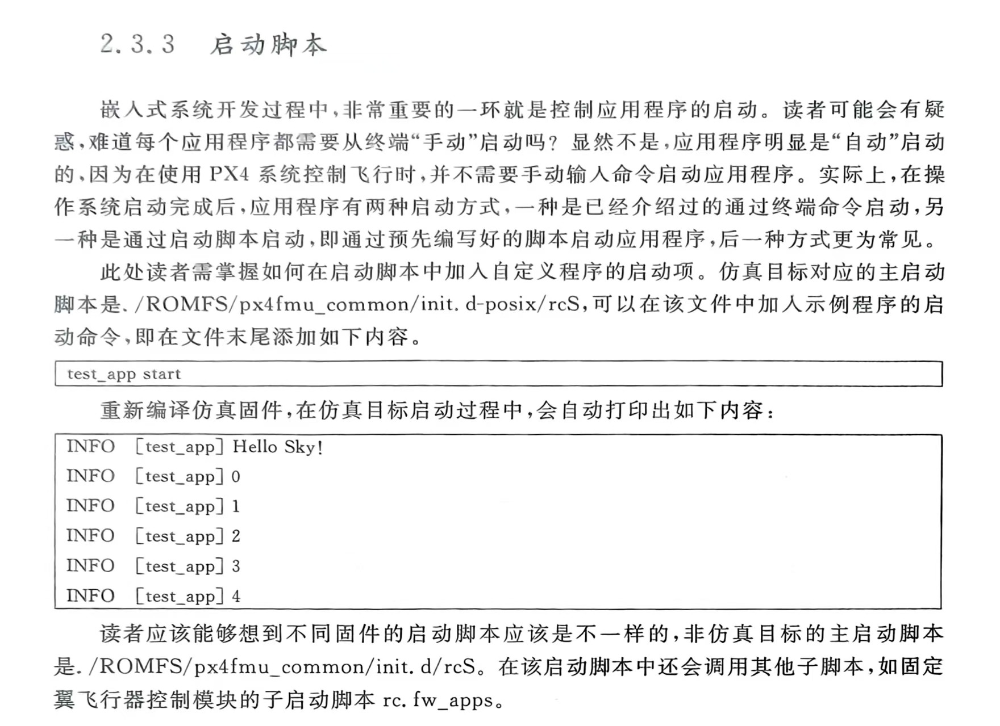


# 附件


## kconfig 用法

可以把 Kconfig 理解为一套配置描述语言及其配置系统。它用于声明软件有哪些可配置选项、每个选项的数据类型、默认值、依赖关系，以及用户或板级配置可以选择哪些功能。

Kconfig 并不负责直接编译 C/C++ 源码。它描述配置，配置系统负责解析配置并生成配置结果，构建系统（PX4 使用 CMake）再根据这些结果组织编译。

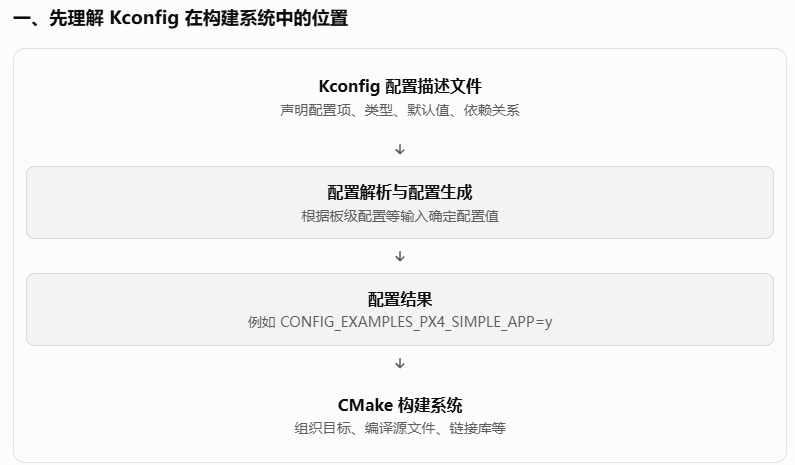


### 基本语法

之前看到的 `src/examples/px4_simple_app/Kconfig` 内容是：

```
menuconfig EXAMPLES_PX4_SIMPLE_APP
    bool "px4_simple_app"
    default n
    ---help---
        Enable support for px4_simple_app
```

| 语法                                | 专业含义                  | 作用                                           |
| ----------------------------------- | ------------------------- | ---------------------------------------------- |
| `menuconfig`                        | 菜单配置项声明            | 声明配置符号，也可以作为一组子配置项的菜单入口 |
| `EXAMPLES_PX4_SIMPLE_APP`           | 配置符号（config symbol） | 配置项的唯一标识符                             |
| `bool`                              | 布尔类型（Boolean type）  | 配置值为启用或禁用                             |
| `"px4_simple_app"`                  | 提示文本（prompt）        | 在配置界面中显示的名称                         |
| `default n`                         | 默认值（default value）   | 默认禁用该功能                                 |
| `---help---`                        | 帮助文本标记              | 为配置项提供说明                               |
| `Enable support for px4_simple_app` | 帮助文本内容              | 解释这个配置项控制什么功能                     |

1. `menuconfig` 声明配置符号

   这里的 `EXAMPLES_PX4_SIMPLE_APP` 就是配置符号。

   在配置结果中，它通常会表现为(在 PX4 的 `.px4board` 文件中，你可能直接看到)：它表达的是板级构建配置希望启用这个功能。

   ```
   CONFIG_EXAMPLES_PX4_SIMPLE_APP=y、
   ```

   `EXAMPLES_PX4_SIMPLE_APP`：Kconfig 中声明的配置符号。

   `CONFIG_EXAMPLES_PX4_SIMPLE_APP`：在常见配置输出格式中带有 `CONFIG_` 前缀的配置名称。

   `y`：表示该布尔配置项已启用。

2. `bool`：布尔配置类型

   `y`：启用（enabled）。

   `n`：禁用（disabled）。

   > 注意：配置项被设为 `y`，不等于对应代码一定已经编译进最终固件。 构建脚本仍然需要根据配置结果选择相应的源文件、目标或模块。

   Kconfig 不只有 `bool`，常见类型还包括：

   | 类型       | 含义                    | 示例              |
   | ---------- | ----------------------- | ----------------- |
   | `bool`     | 布尔类型，启用或禁用    | `default n`       |
   | `tristate` | 三态类型：`y`、`m`、`n` | `default m`       |
   | `int`      | 整数类型                | `default 10`      |
   | `hex`      | 十六进制整数类型        | `default 0x20`    |
   | `string`   | 字符串类型              | `default "hello"` |

   对于 PX4 初学者，先重点理解 `bool` 即可。`tristate` 中的 `m` 通常表示模块形式，但其具体含义取决于使用 Kconfig 的项目；不要直接将其理解为 PX4 中所有动态模块的通用开关。

3. `default`：默认值

   `default` 用于指定配置项在没有其他有效设置时采用的默认值。

   `default n` 表示默认禁用。

   默认值不等于最终值。 如果板级配置或其他有效配置输入明确指定了该选项，最终结果可能与默认值不同。

4. `config` 与 `menuconfig` 的区别

   这是初学者容易混淆的两个关键字。

   `config` 用于声明一个配置项：

   ```
   config EXAMPLE_FEATURE
       bool "Example feature"
       default n
   ```

   `menuconfig` 同样声明配置项，但它还可以作为配置菜单的入口，组织其下的子配置项。

   例如：

   ```
   menuconfig EXAMPLES
       bool "Examples"
       default y
   
   if EXAMPLES
   
   config EXAMPLES_HELLO
       bool "Hello example"
       default n
   
   config EXAMPLES_TIMER
       bool "Timer example"
       default n
   
   endif
   ```

   这个例子使用了 `if` 条件块：当 `EXAMPLES` 不成立时，其中的子配置项不满足该条件。

   这里先记住：`config` 负责声明配置项；`menuconfig` 适合需要组织子配置项的场景。 不必一开始就研究复杂的菜单层级。

5. `depends on`：依赖条件

   `depends on` 用于声明配置项成立或可见所需要满足的条件。

   ```
   config EXAMPLE_SENSOR
       bool "Enable sensor"
       default n
   
   config EXAMPLE_SENSOR_CALIBRATION
       bool "Enable sensor calibration"
       depends on EXAMPLE_SENSOR
       default n
   ```

   这里的 `EXAMPLE_SENSOR_CALIBRATION` 依赖于 `EXAMPLE_SENSOR`。

   从逻辑上理解，只有传感器功能启用时，校准功能才具备启用的条件。实际 Kconfig 中，依赖关系可能影响配置项的可见性及其允许取值，不应简单理解为自动修改另一个配置项。

6.  `select`：反向选择配置项

   `select` 可以让一个配置项启用时，强制将另一个配置符号的下限提高到 `y`，常用于选择底层功能或依赖项。

   ```
   config EXAMPLE_DRIVER
       bool "Enable example driver"
       select EXAMPLE_LIBRARY
       default n
   
   config EXAMPLE_LIBRARY
       bool
       default n
   ```

   当 `EXAMPLE_DRIVER=y` 时，`EXAMPLE_LIBRARY` 会被选中。

   需要注意，`select` 不会自动满足被选择项自身的全部依赖条件。因此，在实际项目中不能随意用它替代 `depends on`；如果配置之间存在复杂依赖，可能产生不一致的配置结果。

   初学阶段可以先记住：

   + `depends on`：当前配置项受条件约束。
   + `select`：当前配置项启用时，推动另一个配置项启用。

7.  `if`：条件配置块

   `if` 用于对一组配置项统一施加条件。

   ```
   if ARCH_ARM
   
   config EXAMPLE_ARM_FEATURE
       bool "ARM-specific feature"
       default n
   
   endif
   ```

   这里的 `ARCH_ARM` 是示例中的条件符号，表示这组配置与 ARM 架构条件关联。它只是示例，不代表你当前 PX4 版本中一定存在这个具体符号。

   当多个配置项具有相同条件时，使用 `if ... endif` 可以避免重复书写 `depends on`。


### Kconfig 与 CMakeList.txt.px4_board 关系


结合你目前的 PX4 源码，最重要的是区分三种机制：

1. Kconfig 配置机制：声明功能选项，解析配置输入，生成配置结果。
2. CMake 目录与目标机制：通过 `add_subdirectory()`、`px4_add_module()` 等命令组织构建目标。
3. 模块选择与固件集成机制：决定哪些模块真正参与当前目标的编译、链接和固件生成。


| 文件                     | 职责                                                         |
| ------------------------ | ------------------------------------------------------------ |
| `Makefile`               | 接收 `make px4_sitl_default` 等构建命令，并把目标交给构建系统 |
| `cmake/px4_config.cmake` | 解析构建目标名称，确定对应的板级配置文件和板卡目录           |
| `cmake/kconfig.cmake`    | 调用 Kconfig 工具，生成配置结果，并把配置内容转换为 CMake 可使用的变量和模块列表 |

PX4 根目录的 `CMakeLists.txt` 会先后执行：、

```cmake
include(px4_config)
include(kconfig)
```


1. 第一步：根据构建目标找到 `.px4board`

   例如你执行：

   ```
   make px4_fmu-v5_default
   ```

   `Makefile` 会根据目标名称调用 CMake 构建流程。`cmake/px4_config.cmake` 会扫描 `boards/` 下的 `.px4board` 文件，并匹配目标名称。

   因此：

   ```
   px4_fmu-v5_default
           ↓
   boards/px4/fmu-v5/default.px4board
   ```

   这里需要区分：`px4_fmu-v5_default` 是构建目标名称，`default.px4board` 才是实际的板级配置文件。 这个映射由 PX4 的构建脚本实现，不是单纯因为文件名相同就由 CMake 自动推导出来的.`cmake/px4_config.cmake`

2.  第二步：解析 Kconfig 描述文件

   根目录的 `Kconfig` 是整个配置体系的入口。它会通过 `source` 指令引入其他 Kconfig 文件，例如：

   ```
   menu "examples"
   source "src/examples/Kconfig"
   endmenu
   ```

   这样，`src/examples/Kconfig` 及其进一步引入的配置文件就成为整个 Kconfig 配置树的一部分。

   你之前找到的：

   ```
   src/examples/px4_simple_app/Kconfig
   ```

   就是其中一个具体功能的配置描述文件。

   注意：Kconfig 文件之间通过 `source` 建立配置描述的包含关系，而不是通过 CMake 的 `add_subdirectory()` 调用。

3.  第三步：`cmake/kconfig.cmake` 执行配置解析

   在当前 PX4 `main` 分支的实现中，`cmake/kconfig.cmake` 使用 Python 的 Kconfiglib 工具，配置相关的关键变量包括：

   ```
   set(BOARD_DEFCONFIG ...)
   set(BOARD_CONFIG ...)
   set(GENCONFIG_PATH ...)
   ```

   其中：

   + `BOARD_DEFCONFIG`：当前目标的板级默认配置输入。
   + `BOARD_CONFIG`：配置解析后生成的配置文件路径。
   + `GENCONFIG_PATH`：生成 C/C++ 配置头文件所用的工具。

   对 `default` 等常规目标，配置系统根据相应的 `.px4board` 输入生成 `boardconfig`；对于其他配置标签，还可能合并 `default.px4board` 与对应标签的配置文件。随后，`genconfig` 会生成 `px4_boardconfig.h`。


 `CONFIG_EXAMPLES_PX4_SIMPLE_APP` 在哪里决定模块是否参与构建


在你当前研究的 PX4 构建体系中，配置项并不是直接传给 `px4_add_module()` 判断，而是先被 `cmake/kconfig.cmake` 转换成模块路径，再由根目录 `CMakeLists.txt` 加载对应模块。


1. 配置符号如何转换成模块路径

   在 `cmake/kconfig.cmake` 中，PX4 会遍历生成的 `boardconfig` 文件，并根据配置名称的前缀识别不同类型的模块。

   其中，处理 `CONFIG_EXAMPLES` 的逻辑可以概括为：

   ```cmake
   string(REGEX MATCH "^CONFIG_EXAMPLES[^=]+" Examples ${NameAndValue})
   
   if(Examples)
       string(REPLACE "${Name}=" "" Value ${NameAndValue})
       string(REPLACE "CONFIG_EXAMPLES_" "" example ${Name})
       string(TOLOWER ${example} example)
       list(APPEND config_module_list examples/${example})
   endif()
   ```

   这是对源码逻辑的摘录式简化，重点是其中的名称转换过程。当前版本的实现可以在 `cmake/kconfig.cmake` 中找到.

   把你的配置项代入：

   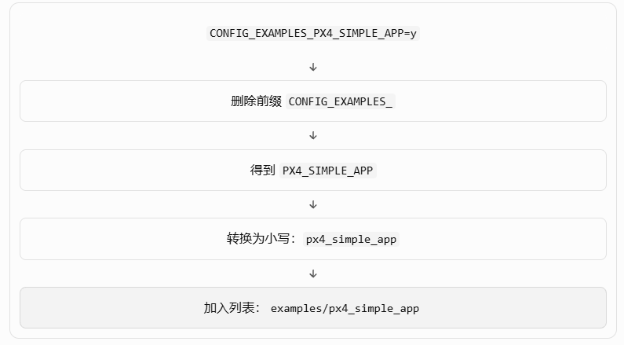


2. `config_module_list` 如何影响 CMake

   接下来，根目录 `CMakeLists.txt` 会遍历 `config_module_list`，将其中的模块目录添加到 CMake 构建系统中。

   其核心逻辑如下：

   ```cmake
   foreach(module ${config_module_list})
       add_subdirectory(src/${module})
   endforeach()
   ```

   

   因此，如果列表中存在：

   ```
   examples/px4_simple_app
   ```

   CMake 就会执行对应目录中的：

   ```
   src/examples/px4_simple_app/CMakeLists.txt
   ```

   其中的 `px4_add_module()` 才会创建具体的模块构建目标。

   

   这就解释了两个看似矛盾的现象：

   + 在 `px4_add_module()` 中找不到配置项的直接判断。
   + 但在 `.px4board` 中设置该配置项，仍然可以决定示例模块是否进入构建流程。

   它们之间的联系是 `cmake/kconfig.cmake` 生成的 `config_module_list`。

下面把板级配置、板级 CMake、模块 Kconfig、模块 CMake，以及根目录文件放到同一张关系图中。

### PX4 配置与构建关系

1. ① 构建入口与板级选择

   根目录 `Makefile`

   接收 `make px4_fmu-v5_default` 等构建命令。

   ```
   cmake/px4_config.cmake
   ```

   解析目标名称，确定 `PX4_BOARD_DIR` 和 `PX4_CONFIG_FILE`。

   ```
   boards/px4/fmu-v5/default.px4board
   ```

   板级配置输入，指定该目标启用哪些 Kconfig 选项。

2. ② Kconfig 描述与配置生成

   根目录 `Kconfig`

   配置树的入口，通过 `source` 引入其他配置描述文件。

   ```
   src/examples/Kconfig
   ```

   组织 example 相关的 Kconfig 配置项。

   ```
   src/examples/px4_simple_app/Kconfig
   ```

   声明 `EXAMPLES_PX4_SIMPLE_APP` 配置符号及其默认值。

   ```
   cmake/kconfig.cmake
   ```

   执行配置解析、生成 `boardconfig` 和 `px4_boardconfig.h`，并构造 `config_module_list`。


3.  ③ CMake 目标创建

   根目录 `CMakeLists.txt`

   遍历 `config_module_list`，通过 `add_subdirectory()` 加载被选中的模块目录。

   ```
   src/examples/px4_simple_app/CMakeLists.txt
   ```

   调用 `px4_add_module()`，定义模块目标、入口和源文件。

   `boards/px4/fmu-v5/CMakeLists.txt`（如果存在）

   由根目录根据目录是否存在而条件性加入，用于板级特定的 CMake 构建定义。

4. ④ 编译、链接与固件生成

   构建系统编译已选中的目标，并根据平台规则将相应模块集成到最终产物。


### 各文件的职责总结

| 文件                                         | 核心职责                                             |
| -------------------------------------------- | ---------------------------------------------------- |
| `boards/.../*.px4board`                      | 选择配置项                                           |
| `boards/.../CMakeLists.txt`                  | 定义板级 CMake 构建内容（如果存在）                  |
| 根目录 `Kconfig`                             | 组织整个配置树                                       |
| `src/examples/Kconfig`                       | 组织 example 配置项                                  |
| `src/examples/px4_simple_app/Kconfig`        | 声明具体示例的配置符号                               |
| 根目录 `CMakeLists.txt`                      | 组织整个工程的 CMake 构建目标                        |
| `src/examples/px4_simple_app/CMakeLists.txt` | 定义具体示例模块的 CMake 目标                        |
| `cmake/kconfig.cmake`                        | 将 Kconfig 配置结果转换成 CMake 可用的变量和模块列表 |

这里有一个需要特别注意的区别：配置描述文件的包含关系，不等于 CMake 源码目录的包含关系。 根目录 `Kconfig` 通过 `source` 组织配置树；根目录 `CMakeLists.txt` 通过 `add_subdirectory()` 组织构建目标。

另外，模块被 `add_subdirectory()` 加载、目标被创建，并不在所有情况下都意味着它一定会被最终链接。你当前示例的 `px4_add_module()` 创建的是 `STATIC EXCLUDE_FROM_ALL` 库，PX4 后续还会把模块加入全局属性，并由平台固件构建逻辑完成集成。


### 验证 Kconfig 配置、CMake 目标创建和模块参与构建

#### 检查根目录 `CMakeLists.txt` 是否引入配置脚本

1. 命令：

   1. 

   ```
   grep -n -E 'include\(px4_config\)|include\(kconfig\)' \
       CMakeLists.txt
   ```

   > | 片段                                          | 含义                                         |
   > | --------------------------------------------- | -------------------------------------------- |
   > | `grep`                                        | 搜索文本                                     |
   > | `-n`                                          | 显示匹配内容所在的行号                       |
   > | `-E`                                          | 启用扩展正则表达式，允许使用 `\|` 表示“或者” |
   > | `'include\(px4_config\)\|include\(kconfig\)'` | 匹配两种 `include(...)` 语句                 |
   > | `CMakeLists.txt`                              | 被搜索的文件                                 |
   >
   > 这里的 `\(` 和 `\)` 用来匹配字面意义上的括号，避免正则表达式把括号当作分组符号。
   >
   > 命令末尾的反斜杠 `\` 是 Bash 的续行符，表示下一行仍然属于同一条命令。它只是方便排版，不是 `grep` 的参数。

2. 输出：

   2. 

   ```
   220:include(px4_config)
   221:include(kconfig)
   ```

   验证 PX4 根目录的 `CMakeLists.txt` 是否显式引入了 `px4_config.cmake` 和 `kconfig.cmake`。

   表示根目录 `CMakeLists.txt` 第 220 行和第 221 行分别包含这两条语句。

   + `include(px4_config)`：引入 PX4 的构建目标解析和板级配置相关逻辑。
   + `include(kconfig)`：引入 Kconfig 配置处理逻辑。

   CMake 的 `include()` 会执行指定的 CMake 脚本。对于省略 `.cmake` 后缀的名称，CMake 会按相应的脚本搜索规则查找文件。

   这两条语句相当于把配置处理代码接入根项目的 CMake 配置过程。它们不是在执行 `px4_simple_app.c`，而是在为后续的构建目标选择、配置变量生成等工作准备环境。

#### 检查根目录 `Kconfig` 如何引入不同类别的配置

1. 命令

   ```
   grep -n -E 'source.*examples|source.*drivers|source.*modules' \
       Kconfig
   ```

   > + `grep -n`：搜索并显示行号。
   > + `-E`：允许使用正则表达式中的 `|`。
   > + `source.*examples`：匹配包含 `source`、随后任意字符、再出现 `examples` 的行。
   > + `source.*drivers` 和 `source.*modules`：同理。
   > + `Kconfig`：指定根配置描述文件。
   >
   > 这里的 `.*` 表示任意字符序列，因此不要求 `source` 与 `examples` 紧挨着。

   确认 PX4 的根目录 `Kconfig` 是否把驱动、模块和示例程序的配置描述纳入统一的配置树。

2. 输出

   ```
    257:source "src/drivers/Kconfig"
    261:source "src/modules/Kconfig"
    269:source "src/examples/Kconfig"
   ```

   这三条结果表明，根目录 `Kconfig` 在对应行引入了：

   ```
   src/drivers/Kconfig
   src/modules/Kconfig
   src/examples/Kconfig
   ```

   这里的 `source` 是 Kconfig 语言自身的文件包含指令，不是 CMake 命令。

   它使这些文件中声明的配置项成为整个 Kconfig 配置树的一部分。

#### 检查 `src/examples/Kconfig` 如何引入子目录

1. 命令

   ```
   cat src/examples/Kconfig
   ```

   确认 `src/examples/Kconfig` 是手动逐一引入示例配置，还是通过通配规则引入子目录中的 Kconfig 文件。

2. 输出

   ```
   rsource "*/Kconfig"
   ```

   这是 Kconfiglib 支持的相对路径包含指令：

   + `rsource`：相对当前 Kconfig 文件所在目录解析路径。
   + `"*/Kconfig"`：通配模式，匹配当前目录下一层子目录中名为 `Kconfig` 的文件。

   因此，像下面这样的文件：

   ```
   src/examples/px4_simple_app/Kconfig
   ```

   可以通过这条规则被引入。

   这使得新增示例配置时，不必总是在 `src/examples/Kconfig` 中手动添加一条 `source` 语句。

   不过要注意，`rsource "*/Kconfig"` 是配置文件包含规则，不会执行任何 CMake 构建操作。它只让配置解析器能够读取这些配置声明。

#### 检查 `cmake/kconfig.cmake` 如何把配置项转换为模块路径

1. 命令

   ```
   grep -n -A 18 -B 5 'CONFIG_EXAMPLES' \
       cmake/kconfig.cmake
   ```

   > | 片段                  | 含义                   |
   > | --------------------- | ---------------------- |
   > | `grep -n`             | 显示匹配行及行号       |
   > | `-A 18`               | 显示匹配行之后的 18 行 |
   > | `-B 5`                | 显示匹配行之前的 5 行  |
   > | `'CONFIG_EXAMPLES'`   | 搜索包含该字符串的行   |
   > | `cmake/kconfig.cmake` | 被检查的文件           |
   >
   > `-A` 是 after，`-B` 是 before。二者可以帮助你同时看到匹配语句的上下文，而不只是孤立的一行。

   它用来确认：

   PX4 是否会根据 `CONFIG_EXAMPLES_...` 这样的配置名称，自动生成对应的模块目录路径。

2. 输出

   ```cmake
   string(REGEX MATCH "^CONFIG_EXAMPLES[^=]+" Examples ${NameAndValue})
   
   if(Examples)
       string(REPLACE "${Name}=" "" Value ${NameAndValue})
       string(REPLACE "CONFIG_EXAMPLES_" "" example ${Name})
       string(TOLOWER ${example} example)
   
       list(APPEND config_module_list examples/${example})
   endif()
   ```

   > 1. 首先
   >
   >    1. 
   >
   >    ```
   >    string(REGEX MATCH "^CONFIG_EXAMPLES[^=]+" Examples ${NameAndValue})
   >    ```
   >
   >    这里使用 CMake 的 `string(REGEX MATCH ...)` 进行正则匹配。
   >
   >    + `^CONFIG_EXAMPLES`：要求字符串从 `CONFIG_EXAMPLES` 开始。
   >    + `[^=]+`：匹配一个或多个不等于 `=` 的字符。
   >    + `Examples`：保存匹配结果的变量名。
   >    + `${NameAndValue}`：待处理的配置文本。
   >
   >    例如，假设当前处理的文本是：`CONFIG_EXAMPLES_PX4_SIMPLE_APP=y`
   >
   >    那么匹配部分为：`CONFIG_EXAMPLES_PX4_SIMPLE_APP`
   >
   > 2. 接下来：
   >
   >    2. 
   >
   >    ```
   >    if(Examples)
   >    ```
   >
   >    检查变量 `Examples` 是否非空。如果匹配到了 `CONFIG_EXAMPLES` 前缀，就进入这个条件分支。
   >
   > 3. 然后
   >
   >    ```
   >    string(REPLACE "${Name}=" "" Value ${NameAndValue})
   >    ```
   >
   >    从配置文本中移除变量名和等号部分，提取配置值。具体结果取决于前面循环中 `Name` 和 `NameAndValue` 的赋值方式。
   >
   > 4. 接下来是关键的名称转换：
   >
   >    ```
   >    string(REPLACE "CONFIG_EXAMPLES_" "" example ${Name})
   >    ```
   >
   >    把配置名称中的 `CONFIG_EXAMPLES_` 前缀删除。
   >
   >    ```
   >    string(TOLOWER ${example} example)
   >    ```
   >
   >    再把剩余部分转换为小写。
   >
   > 5. 最后：
   >
   >    ```
   >    list(APPEND config_module_list examples/${example})
   >    ```
   >
   >    将生成的模块路径追加到 CMake 列表 `config_module_list` 中。

3. 总结：

   对于：

   ```
   CONFIG_EXAMPLES_PX4_SIMPLE_APP=y
   ```

   转换过程如下：

   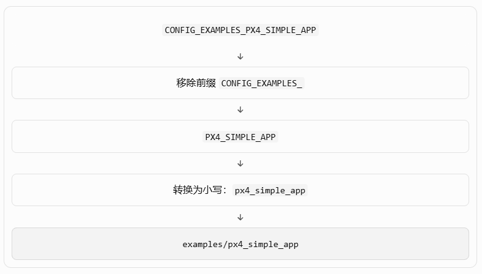里的 `config_module_list` 是配置结果与 CMake 模块目录之间的桥梁。

   它保存的是模块路径，不是源码文件名，也不是配置符号。

#### 检查根目录 `CMakeLists.txt` 如何加载模块


1. 命令：

   1. 

   ```
   grep -n -A 8 -B 5 'config_module_list' \
       CMakeLists.txt
   ```

   > `grep`：搜索文本。
   >
   > `-n`：显示行号。
   >
   > `-A 8`：显示匹配行之后的 8 行。
   >
   > `-B 5`：显示匹配行之前的 5 行。
   >
   > `config_module_list`：搜索变量名。
   >
   > `CMakeLists.txt`：检查根目录构建脚本。

   验证配置系统生成的模块列表，是否真正被根目录 CMake 用来加载模块目录。

   前面的命令已经表明，配置名称可以转换成 `examples/px4_simple_app`。现在要确认根目录是否会根据这个路径进入相应的目录。


2. 输出

   输出最重要的部分：

   ```cmake
   set(config_module_list)
   set(config_kernel_list)
   ```

   ```cmake
   if(EXISTS "${PX4_BOARD_DIR}/CMakeLists.txt")
       add_subdirectory(${PX4_BOARD_DIR})
   endif()
   
   foreach(module ${config_module_list})
       add_subdirectory(src/${module})
   endforeach()
   ```

   > 1. `set(config_module_list)` 这条语句初始化一个空列表。它本身并没有添加任何模块。前面 `cmake/kconfig.cmake` 中的 `list(APPEND config_module_list ...)` 会向列表追加模块路径。
   >
   > 2. `set(config_kernel_list)`初始化另一个列表，用于受保护构建场景下的内核模块分类。
   >
   > 3. `add_subdirectory()` 的作用:
   >
   >    ```cmake
   >    foreach(module ${config_module_list})
   >        add_subdirectory(src/${module})
   >    endforeach()
   >    ```
   >
   >    段代码是配置列表进入 CMake 构建体系的关键。
   >
   >    + `foreach(...)`：遍历 `config_module_list` 中的每个元素。
   >    + `${module}`：当前遍历到的模块路径。
   >    + `add_subdirectory(...)`：处理指定子目录中的 `CMakeLists.txt`，把该目录的构建逻辑加入当前 CMake 项目。
   >
   >    如果当前列表中包含：
   >
   >    ```
   >    examples/px4_simple_app
   >    ```
   >
   >    那么实际处理的目录就是：
   >
   >    ```
   >    src/examples/px4_simple_app
   >    ```
   >
   >    CMake 接下来会读取该目录的 `CMakeLists.txt`，其中的 `px4_add_module()` 才会定义模块构建目标。
   >
   > 4.  先添加板级 CMake，再添加模块
   >
   >    你的输出中还有：
   >
   >    ```
   >    if(EXISTS "${PX4_BOARD_DIR}/CMakeLists.txt")
   >        add_subdirectory(${PX4_BOARD_DIR})
   >    endif()
   >    ```
   >
   >    这表示：如果当前板卡目录中存在 `CMakeLists.txt`，就将它加入构建配置。
   >
   >    随后，根目录才遍历 `config_module_list` 加载模块。
   >
   >    两者职责不同：
   >
   >    + `boards/.../CMakeLists.txt`：板级构建逻辑，前提是对应文件存在。
   >    + `src/${module}/CMakeLists.txt`：配置选中的模块构建逻辑。
   >
   >    并不是所有 `.px4board` 都必须有同目录的 `CMakeLists.txt`；这段代码使用 `if(EXISTS ...)` 做了条件判断。

#### 检查 FMUv5 的配置结果

1. 命令：

   ```sh
   grep -n 'CONFIG_EXAMPLES_PX4_SIMPLE_APP' \
       build/px4_fmu-v5_default/boardconfig
   ```

   检查 FMUv5 这个构建目标最终采用了什么配置值。

   这里检查的不是源码中的 Kconfig 声明，也不是 `.px4board` 原始输入，而是构建目录中的配置结果 `boardconfig`。

2. 输出

   ```sh
   693:# CONFIG_EXAMPLES_PX4_SIMPLE_APP is not set
   ```

   这是 Kconfig 配置文件常用的禁用状态表示方式，含义是：`CONFIG_EXAMPLES_PX4_SIMPLE_APP = n`

   这里的 `#` 并不是说配置项声明不存在，而是配置系统以注释形式记录该布尔选项未启用。

   这说明在当前 `build/px4_fmu-v5_default` 的配置结果中，`px4_simple_app` 对应的配置项处于禁用状态。

3. 作用

   在 `cmake/kconfig.cmake` 遍历配置结果时，禁用的配置项不会以 `CONFIG_EXAMPLES_PX4_SIMPLE_APP=y` 这样的启用形式进入模块选择逻辑。

   因此，按前面分析的前缀转换机制，这个选项不会因为启用状态而把 `examples/px4_simple_app` 添加到 `config_module_list`。


#### 检查 SITL 的配置结果

1. 命令：

   ```sh
   grep -n 'CONFIG_EXAMPLES_PX4_SIMPLE_APP' \
       build/px4_sitl_default/boardconfig
   ```

   用 SITL 的配置结果与 FMUv5 进行对比，验证同一个 Kconfig 选项是否会因构建目标不同而有不同取值。

2. 输出

   ```sh
   675:CONFIG_EXAMPLES_PX4_SIMPLE_APP=y
   ```

   说明 SITL 的配置结果中，该选项被启用。

   对比两个构建目标：

   | 检查项目 | FMUv5                                  | SITL                                 |
   | -------- | -------------------------------------- | ------------------------------------ |
   | 配置文件 | `build/px4_fmu-v5_default/boardconfig` | `build/px4_sitl_default/boardconfig` |
   | 配置结果 | `is not set`                           | `=y`                                 |
   | 配置状态 | 禁用                                   | 启用                                 |

   这与你之前检查 `.px4board` 的结果相互印证：SITL 的 `default.px4board` 显式启用了该配置，而 FMUv5 的 `default.px4board` 没有显式设置它。

3. 作用

   当 SITL 配置解析逻辑遍历到：

   ```
   CONFIG_EXAMPLES_PX4_SIMPLE_APP=y
   ```

   就会根据 `CONFIG_EXAMPLES_` 前缀规则生成：

   ```
   examples/px4_simple_app
   ```

   并把它加入 `config_module_list`。

   根目录 `CMakeLists.txt` 随后通过 `add_subdirectory()` 加载相应目录，执行该模块的 `CMakeLists.txt`。

   这就是从板级配置到模块构建目标的连接过程。

#### 检查 CMake 是否生成了模块目标


1. 命令：

   ```
   cmake --build build/px4_sitl_default \
       --target help | grep 'examples__px4_simple_app'
   ```

   | 片段                              | 含义                                         |
   | --------------------------------- | -------------------------------------------- |
   | `cmake --build`                   | 通过 CMake 调用底层构建工具                  |
   | `build/px4_sitl_default`          | 指定已有的构建目录                           |
   | `--target help`                   | 请求底层构建系统列出可用目标                 |
   | `\|`                              | Shell 管道，将左侧命令的标准输出传给右侧命令 |
   | `grep 'examples__px4_simple_app'` | 过滤出名称包含该字符串的目标                 |

   检查当前 SITL 构建目录中，CMake 生成的构建系统是否认识 `px4_simple_app` 对应的目标


2. 输出：

   ```sh
   examples__px4_simple_app: phony
   libexamples__px4_simple_app.a: phony
   ```

   这表明构建系统识别了两个相关目标：

   + `examples__px4_simple_app`：PX4 模块对应的 CMake 目标名称。
   + `libexamples__px4_simple_app.a`：静态库相关的构建目标名称。

   之前提供的模块定义中：

   ```
   px4_add_module(
       MODULE examples__px4_simple_app
       MAIN px4_simple_app
       SRCS
           px4_simple_app.c
       DEPENDS
   )
   ```

   `MODULE` 参数明确指定了 `examples__px4_simple_app` 这个目标名称。

   在 `cmake/px4_add_module.cmake` 中，普通静态模块的分支使用：

   ```
   add_library(${MODULE} STATIC EXCLUDE_FROM_ALL ${SRCS})
   ```

   因此，这个模块会被定义为静态库目标。

   输出中 `phony` 是构建工具显示的目标类型标记，通常表示一个不直接对应同名磁盘文件的构建目标。


